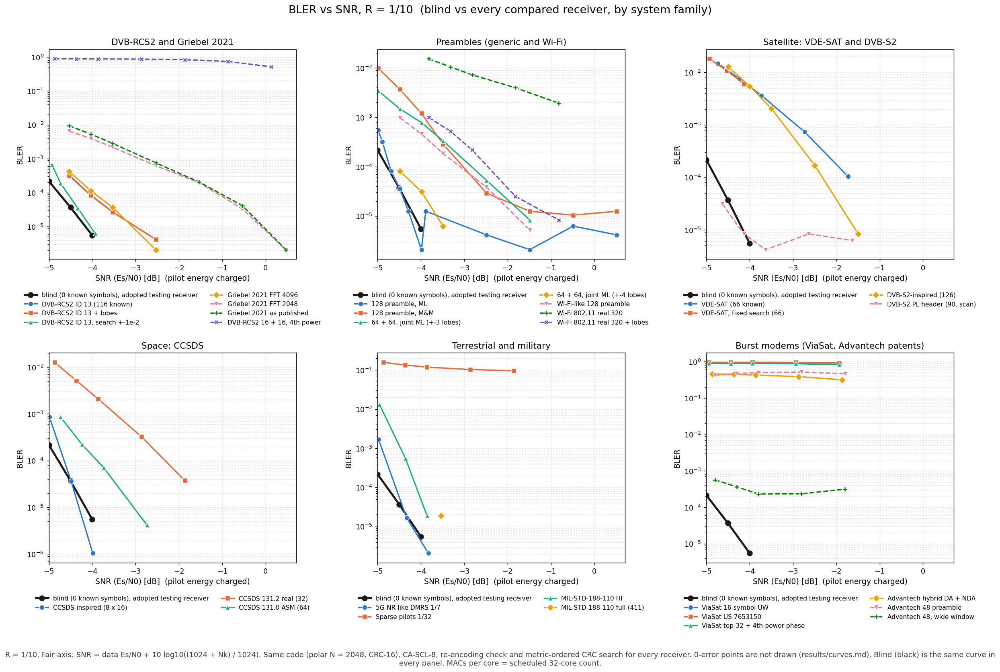
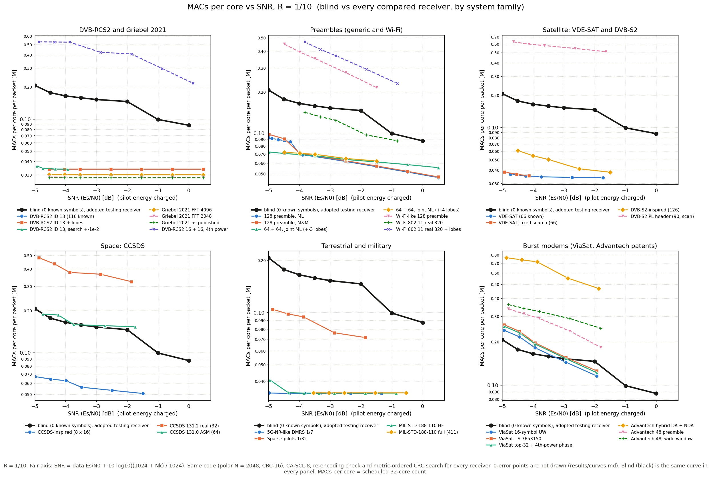
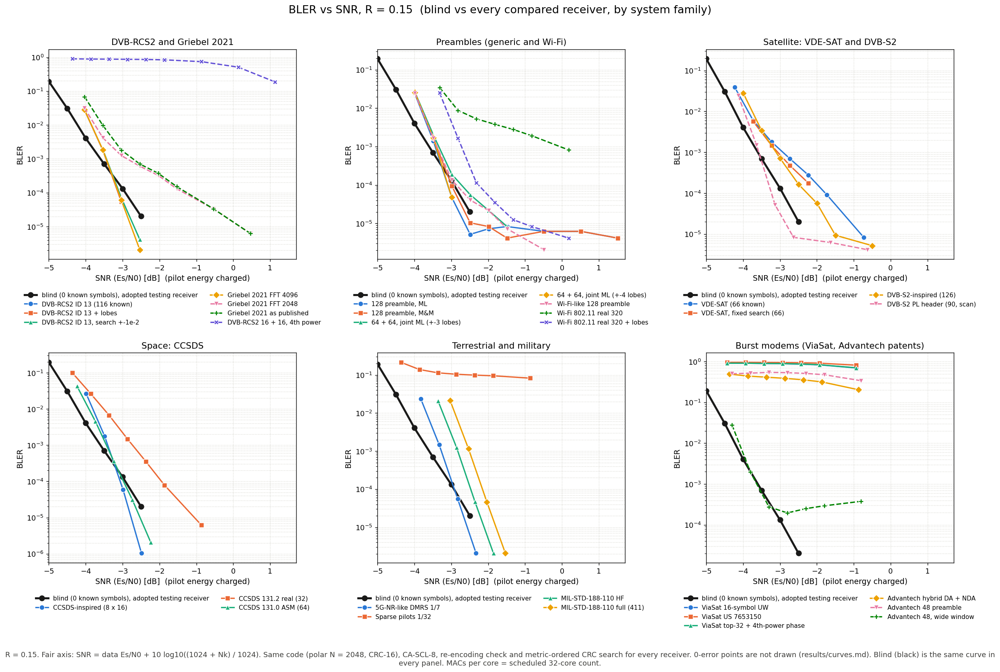
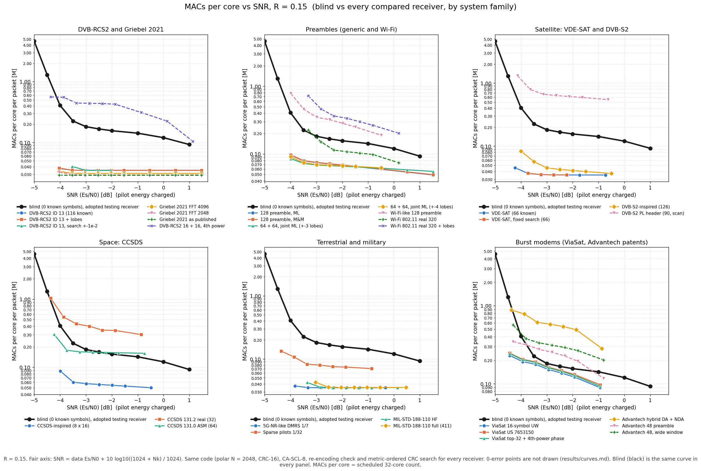
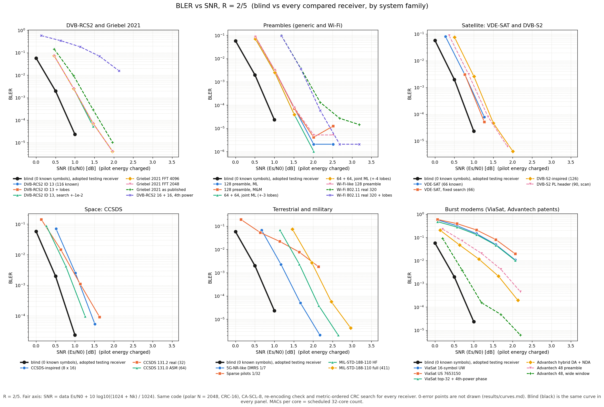
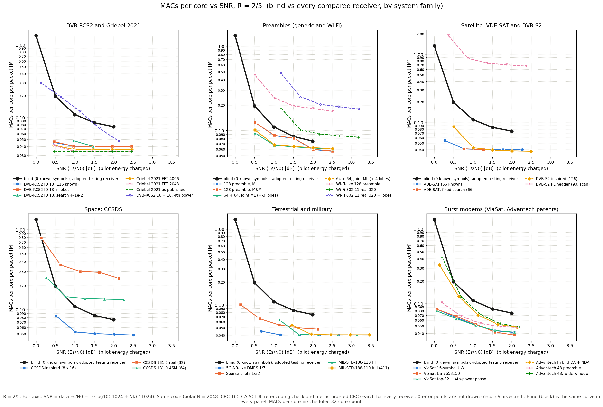
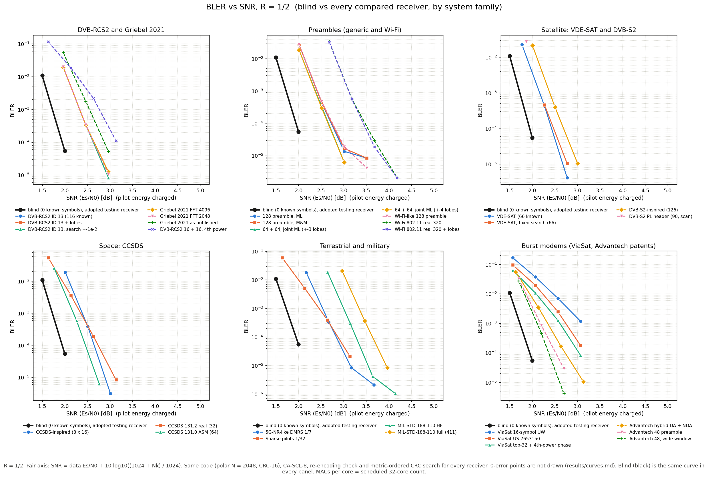
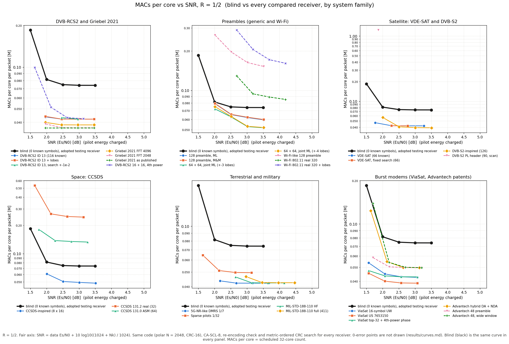

# The blind CFO receiver: architecture and formulas

This folder explains the final blind (zero-pilot) receiver of the small-CFO study: its architecture, every method and every formula. The study covers a 1024-symbol QPSK packet with a polar code (N = 2048, CRC-16) and |f| ≤ 0.03 cycles/symbol. Every formula below is the one in the code, and every parameter is the value the final runs used.

| File | Content |
|---|---|
| [01_signal_model.md](01_signal_model.md) | Transmit chain, received model, conventions, SNR |
| [02_fast_path.md](02_fast_path.md) | Stage 1: 4th-power CFO, pre-MF correction, carrier phase, the π ambiguity (PiCode), one decode |
| [03_path_metric.md](03_path_metric.md) | The decoder as a CFO detector: the list-1 Fast-SSC path metric, why it separates right from wrong hypotheses |
| [04_search.md](04_search.md) | Stage 2: the CFO × phase grid, checkpoints and the robust z-test, coarse start, batches on 32 cores, the checkpoint NN |
| [05_decoding.md](05_decoding.md) | Stage 3: refinement, CA-SCL-8, joint list decoding, code-aided retry, rescue, F5 frozen-bit early stop (5.8) |
| [06_acceptance.md](06_acceptance.md) | CRC-16 with PiCode, the re-encoding check, false-alarm maths |
| [07_complexity.md](07_complexity.md) | MAC model, MACs per core (the standard 32-core model), measured MACs, where they go, the 128-pilot comparison, a hard MAC cap |
| [08_parameters_results.md](08_parameters_results.md) | Every parameter per rate; BLER of blind, the genie and the 128-pilot receivers per rate; undetected errors; throughput |
| [presentation/](presentation/README.md) | The presentation figures per rate: the fair blind-vs-pilot comparison (`bler_fair`, `macs_fair`, 2026-11-15: pilots outside the packet, energy charged, DVB-RCS2 included), BLER vs MAC cap, stages |
| **[DEAD_ENDS.md](DEAD_ENDS.md)** | **Every idea that was tried and dropped, with the evidence: check it before testing a new idea** |

## Block diagram

Black and white, also as [PDF](block_diagram.pdf) and [SVG](block_diagram.svg). Redraw it with `python BLIND_IMPLEMENTATION/make_block_diagram.py`.

## Rates

| Rate | Data bits A | Receiver settings |
|---|---|---|
| R = 1/10 | 205 | `S blind final v2` |
| **R = 0.15** | 307 | the R = 1/10 settings (`blind_cfo.PROFILE`), with its own re-encoding threshold table RHO_N (calibrated as for the other rates, see [06_acceptance.md](06_acceptance.md)) |
| R = 2/5 | 819 | `S blind final 2/5, 1/2, best-first 32` |
| R = 1/2 | 1024 | `S blind final 2/5, 1/2` |

## The idea in one paragraph

Without pilots, the only things the receiver knows about the packet are the modulation (QPSK) and the **code**. The receiver uses the modulation first:
- −r⁴ removes QPSK, leaving a pure tone at 4f, so one FFT gives a CFO estimate.
- It also gives the carrier phase, modulo π/2.

At high SNR that estimate is good enough and a single decode succeeds. Below about 0 dB it is not, so the receiver uses the code. The polar code's **frozen bits act as implicit pilots**: 1827 of the 2048 bits at R = 1/10 are known to be 0. A successive-cancellation decoder run at a CFO / phase hypothesis accumulates a path metric that is small only when the hypothesis is right. The receiver therefore:
1. scores a grid of (CFO, phase) hypotheses with partial decodes;
2. drops weak hypotheses early (checkpoints);
3. fully decodes only the few best;
4. accepts a packet only if CRC-16 **and** a re-encoding correlation check both pass.

**The bit interleaver is essential.** The coded bits are permuted (fixed random permutation) before QPSK mapping.
Without it a π/2 rotation of the QPSK symbols turns every polar codeword into another codeword, the receiver cannot
tell the π/2 phase branches apart, and about a third of the packets fail at any SNR (measured 37 % on the
rate-matched full-system format, 2026-11-17). Why, and the proof: [01_signal_model.md](01_signal_model.md), "Why the
bit interleaver is required".

Code: [small_rx.py](../small_rx.py) (receiver), [blind_fast.py](../blind_fast.py) (path metric, pre-MF correction, re-encoding check), [blind_cfo.py](../blind_cfo.py) (chain, 4th power, PiCode), [blind_ber.py](../blind_ber.py) (final receiver settings `S blind final v2`, `S blind final 2/5, 1/2, best-first 32`, `S blind final 2/5, 1/2`).

## Current state (2026-11-17)

### Which receiver is "blind" now: the adopted testing receiver
The files 01-08 describe the **presentation** receivers. The experiments in [testing/](testing/README.md) produced
the **testing receiver**, which is now the blind receiver in every comparison and figure:

| Rate | Presentation receiver (blind_ber.py) | Adopted testing receiver (testing/run.py) | Changes vs presentation |
|---|---|---|---|
| 1/10, 0.15 | `S blind final v2` | `testing_s11g` | fast path off at SNR <= 0 dB (`s0_snr = 0.5`); 0.15: 4 phase hypotheses below 0.5 dB (`nph`); phase-index fix (`q_fix`); speculative decode `spec11` below 1/10 -3.5 dB, 0.15 -2.5 dB |
| 2/5 | `S blind final 2/5, 1/2, best-first 32` | `base25_qfix_fzs` | `q_fix` + F5: frozen-bit early stop inside each CA-SCL-8 decode (adopted 2026-11-15, [05_decoding.md 5.8](05_decoding.md)) |
| 1/2 | `S blind final 2/5, 1/2` | `base2_qfix_fzs` | `q_fix` + F5 frozen-bit early stop (as 2/5) |

**Improvement over the presentation receiver** (fair axis, all runs of each receiver pooled; MACs per core = the
standard scheduled count, interpolated at each receiver's own crossing):

| Rate, BLER | Presentation: SNR [dB] / M MACs per core | Testing: SNR [dB] (95 % CI) / M MACs per core | MACs per core | BLER |
|---|---|---|---|---|
| 1/10, 1e-4 | -4.80 / 0.317 | -4.78 [-4.86, -4.69] / 0.194 | **-39 %** | same (0.02 dB, inside the CI) |
| 0.15, 1e-3 | -3.61 / 0.387 | -3.60 [-3.67, -3.52] / 0.262 | **-32 %** | same |
| 0.15, 1e-4 | -2.98 / 0.287 | -2.93 [-2.99, -2.83] / 0.180 | **-37 %** | same (0.05 dB, inside the CI) |
| 2/5, 1e-3 | 0.61 / 0.221 | 0.58 [0.55, 0.61] / 0.183 | **-17 %** | same (0.03 dB) |
| 1/2, 1e-3 | 1.78 / not measured at the crossing | 1.73 [1.69, 1.76] / 0.139 | -20 % at 1.5 dB (early stop, paired); -2 % at 2 dB, 0 % at 2.5 dB | same (0.05 dB) |

- The BLER changes are packet-set noise, not gains: on paired packets every adopted change kept the BLER (McNemar
  counts within +-1 per change, `testing/results/expected_s11.md`, `expected_f3f5.md`). The gain is complexity.
- At 1/2 the presentation receiver has per-core MACs only at 2 and 2.5 dB, so the gain at the crossing (1.73 dB) is
  the paired early-stop result at 1.5 dB: -20.4 % per core, 18 lost packets in 128k, crossing shift <= 0.003 dB.

### Full curves: BLER vs SNR and MACs per core vs SNR (every receiver, every simulated point)
The crossings below are a summary only. The full curves of blind and all 31 compared receivers, one panel per
system family (blind in every panel), are in `testing/results/plots/` and every point (errors / packets, BLER, MACs per
core) is tabulated in **[testing/results/curves.md](testing/results/curves.md)** (`py BLIND_IMPLEMENTATION/testing/plot_curves.py`).

| Rate | BLER vs SNR | MACs per core vs SNR |
|---|---|---|
| 1/10 | [curves_bler_R10.png](testing/results/plots/original_study/curves_bler_R10.png) | [curves_macs_R10.png](testing/results/plots/original_study/curves_macs_R10.png) |
| 0.15 | [curves_bler_R15.png](testing/results/plots/original_study/curves_bler_R15.png) | [curves_macs_R15.png](testing/results/plots/original_study/curves_macs_R15.png) |
| 2/5 | [curves_bler_R25.png](testing/results/plots/original_study/curves_bler_R25.png) | [curves_macs_R25.png](testing/results/plots/original_study/curves_macs_R25.png) |
| 1/2 | [curves_bler_R2.png](testing/results/plots/original_study/curves_bler_R2.png) | [curves_macs_R2.png](testing/results/plots/original_study/curves_macs_R2.png) |

What the MACs curves show: blind's cost falls with SNR (0.21 -> 0.09 M per core at 1/10 from -5 to 0 dB) because more
packets finish in the early stages; the cheap pilot receivers stay at 0.03-0.10 M (one decode plus a few CRC-search
decodes); the scanning / wide-window layouts (DVB-S2 header, Wi-Fi 320, CCSDS 131.2 real, Advantech 48) sit at or above
blind.

### Blind vs the real preamble / pilot systems (fair axis, pilot energy charged)
31 receivers from 12 deployed-system families were simulated on our burst (same code, decoder, re-encoding check,
CRC search, CFO range; each with its own known-symbol layout and estimator): DVB-RCS2 (and Griebel 2021), plain 128
preambles, 64 + 64 pre/post, VDE-SAT, DVB-S2, CCSDS (inspired, 131.2 real, 131.0 ASM), ViaSat (two patents), 5G-NR-like
DMRS, sparse pilots, Wi-Fi 802.11, MIL-STD-188-110 and the Advantech hybrid preamble. Full table per target:
**[testing/results/scoreboard.md](testing/results/scoreboard.md)**. Gap = competitor - blind, + = blind better:

| Rate, BLER | Blind [dB] | Closest competitors (gap [dB]) | Blind loses to | Fails the target |
|---|---|---|---|---|
| 1/10, 1e-4 | -4.78 | **128 preamble ML +0.06 (tie)**, CCSDS-inspired +0.13, 64 + 64 L4 ~+0.18 (not bracketed), DMRS 1/7 +0.20, **DVB-RCS2 with the fixed search +0.20** (was +0.69 with the old search) | none measured; DVB-S2 90-symbol header is open (below 1e-4 at -4.63, crossing ~-4.95 ... -4.65) | 10 of 31 (VDE-SAT, ViaSat x3, Advantech x3, sparse 1/32, Wi-Fi 320 without lobes, 4th-power pre/post) |
| 0.15, 1e-3 | -3.60 | Advantech 48 wide -0.03, DVB-S2 header +0.03 (ties), DVB-RCS2 +0.15, 128 ML +0.16, CCSDS 131.0 ASM +0.16 | none (the tie) | 7 |
| 0.15, 1e-4 | -2.93 | - | **DVB-S2 90-symbol header -0.31 (at 0.69 M MACs per core, 3.8x blind), DVB-RCS2 -0.19, 128 ML -0.20, Griebel 4096 -0.18, 64 + 64 L4 -0.17, CCSDS-inspired -0.14** (CIs do not overlap); 128 M&M -0.07, ASM -0.05, DMRS +0.01, Wi-Fi 128 +0.07: ties | 9 |
| 2/5, 1e-3 | 0.58 | Advantech 48 wide +0.33, VDE-SAT +0.34, CCSDS 131.0 ASM +0.38, DVB-S2 header +0.44, DVB-RCS2 +0.52 | none | 5 |
| 1/2, 1e-3 | 1.73 | Advantech 48 wide +0.38, VDE-SAT +0.44, Advantech 48 +0.45, ASM +0.47, DVB-RCS2 +0.61 | none | 1 (ViaSat UW) |

- **Cost:** blind needs 0.14-0.26 M MACs per core at its crossings; the cheap pilot receivers 0.03-0.09 M (blind
  2-7x more). A few faithful layouts are dearer than blind: Wi-Fi 320 (0.34-0.44 M), CCSDS 131.2 real (0.26-0.39 M),
  Advantech 48 wide at 0.15 (0.36 M), DVB-S2 header scan (0.63-0.83 M).
- **Typical failure of the competitors:** coarse-CFO misses outside their search window (Advantech wide floor ~2.5e-4,
  Wi-Fi 320 wrap floor ~1e-2 at 1/10) and shallow waterfalls with few pilots (CCSDS 131.2 real).
- Blind and the competitors run on different packets: gaps under ~0.1 dB are ties. Timing / burst detection is
  assumed known for everyone (it favours blind: a preamble also does detection).
- **Fixed-search check (2026-11-17, `testing/results/expected_fx.md`):** three code reviews found search holes in several
  competitors. Re-run of the three key ones: DVB-RCS2 with a +-1e-2 search (covers its pre/post side peaks) gains
  0.49 dB at 1/10 (gap +0.69 -> +0.20), unchanged elsewhere; the 128-preamble control reproduces its old numbers;
  VDE-SAT with an unclipped window still misses 0.6-2 % of packets at 1/10 (full-range scan running). Other flagged
  competitors (Advantech 48 wide, sparse 1/32, 64 + 64, DVB-S2-inspired, Wi-Fi) are not re-run yet: their gaps to blind
  are likely overstated (blind's lead too large).
- Still running (2026-11-17): DVB-S2 SOF26 at every rate, DVB-S2 header at 1/2, and the 1/10 -5.3 dB point for the
  DVB-S2 header (v-10hla/hlb, 960k packets). Per-job results with
  predictions: `testing/results/expected_variants.md` §9, news in [NEWS.md](NEWS.md).
- **Full systems (their own FEC, burst, pilots and DA sync, equal payload; DVB-RCS2 IDs 3/13/14/42, VDE-SAT Link 32):** [fullsys/README.md](../fullsys/README.md).

### Real-world checks
Wiener phase noise (linewidth x Ts): 1e-5 harmless; 1e-4 x3 BLER at 1/10, 0.15 and x36 BLER, x10 MACs per core at 2/5;
3e-4 x100-235. Code-aided phase tracking (`pns`) cuts blind's BLER 10-23 % at 1e-4. Phase tracking is the main open
real-world item (`testing/results/expected_cap_pn_comb.md`, `expected_pns.md`). Noise-only packets: 0 false alarms in
~30k. A hard MAC cap (2 M per core at 1/10, 0.15; 1 M at 2/5, 1/2) costs ~1e-5 BLER at the waterfall foot.

Details and reports: [testing/README.md](testing/README.md), `testing/results/report_*.md`, plots in `testing/results/plots/`.
