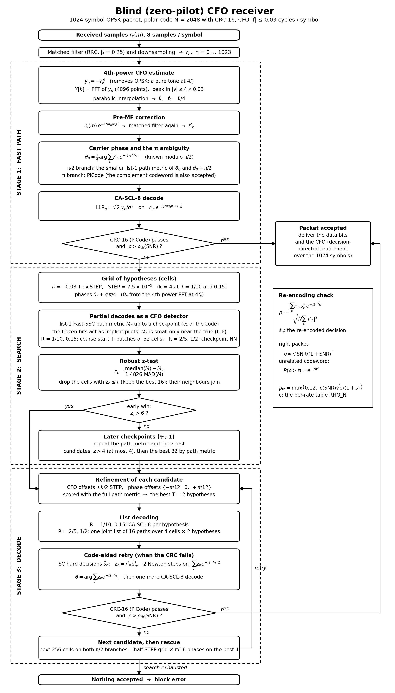

# The blind CFO receiver: architecture and formulas

This folder explains the final blind (zero-pilot) receiver of the small-CFO study: its architecture, every method and every formula. The study covers a 1024-symbol QPSK packet with a polar code (N = 2048, CRC-16) and |f| ≤ 0.03 cycles/symbol. Every formula below is the one in the code, and every parameter is the value the final runs used.

| File | Content |
|---|---|
| [01_signal_model.md](01_signal_model.md) | Transmit chain, received model, conventions, SNR |
| [02_fast_path.md](02_fast_path.md) | Stage 1: 4th-power CFO, pre-MF correction, carrier phase, the π ambiguity (PiCode), one decode |
| [03_path_metric.md](03_path_metric.md) | The decoder as a CFO detector: the list-1 Fast-SSC path metric, why it separates right from wrong hypotheses |
| [04_search.md](04_search.md) | Stage 2: the CFO × phase grid, checkpoints and the robust z-test, coarse start, batches on 32 cores, the checkpoint NN |
| [05_decoding.md](05_decoding.md) | Stage 3: refinement, CA-SCL-8, joint list decoding, code-aided retry, rescue |
| [06_acceptance.md](06_acceptance.md) | CRC-16 with PiCode, the re-encoding check, false-alarm maths |
| [07_complexity.md](07_complexity.md) | MAC model, MACs per core (the standard 32-core model), measured MACs, where they go, the 128-pilot comparison, a hard MAC cap |
| [08_parameters_results.md](08_parameters_results.md) | Every parameter per rate; BLER of blind, the genie and the 128-pilot receivers per rate; undetected errors; throughput |
| [presentation/](presentation/) | The presentation figures (BLER, MACs, BLER vs MAC cap, stages) per rate |

## Block diagram

Black and white, also as [PDF](block_diagram.pdf) and [SVG](block_diagram.svg). Redraw it with `python BLIND_IMPLEMENTATION/make_block_diagram.py`.

## Rates

| Rate | Data bits A | Receiver settings |
|---|---|---|
| R = 1/10 | 205 | `S blind final v2` |
| **R = 0.15** | 307 | the R = 1/10 settings (`blind_cfo.PROFILE`), with its own re-encoding threshold table RHO_N (calibrated as for the other rates, see [06_acceptance.md](06_acceptance.md)) |
| R = 2/5 | 819 | `S blind final 2/5, 1/2, best-first 32` |
| R = 1/2 | 1024 | `S blind final 2/5, 1/2` |

## The idea in one paragraph

Without pilots, the only things the receiver knows about the packet are the modulation (QPSK) and the **code**. The receiver uses the modulation first:
- −r⁴ removes QPSK, leaving a pure tone at 4f, so one FFT gives a CFO estimate.
- It also gives the carrier phase, modulo π/2.

At high SNR that estimate is good enough and a single decode succeeds. Below about 0 dB it is not, so the receiver uses the code. The polar code's **frozen bits act as implicit pilots**: 1827 of the 2048 bits at R = 1/10 are known to be 0. A successive-cancellation decoder run at a CFO / phase hypothesis accumulates a path metric that is small only when the hypothesis is right. The receiver therefore:
1. scores a grid of (CFO, phase) hypotheses with partial decodes;
2. drops weak hypotheses early (checkpoints);
3. fully decodes only the few best;
4. accepts a packet only if CRC-16 **and** a re-encoding correlation check both pass.

Code: [small_rx.py](../small_rx.py) (receiver), [blind_fast.py](../blind_fast.py) (path metric, pre-MF correction, re-encoding check), [blind_cfo.py](../blind_cfo.py) (chain, 4th power, PiCode), [blind_ber.py](../blind_ber.py) (final receiver settings `S blind final v2`, `S blind final 2/5, 1/2, best-first 32`, `S blind final 2/5, 1/2`).
