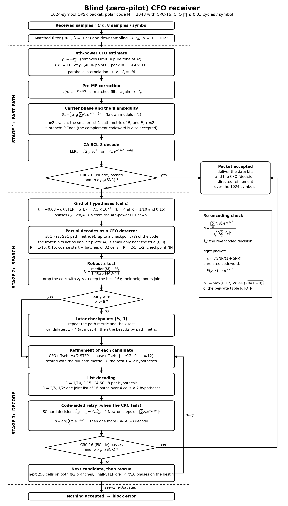

# The blind CFO receiver: architecture and formulas

This folder explains the final blind (zero-pilot) receiver of the small-CFO study: its architecture, every method and every formula. The study covers a 1024-symbol QPSK packet with a polar code (N = 2048, CRC-16) and |f| ≤ 0.03 cycles/symbol. Every formula below is the one in the code, and every parameter is the value the final runs used.

| File | Content |
|---|---|
| [01_signal_model.md](01_signal_model.md) | Transmit chain, received model, conventions, SNR |
| [02_fast_path.md](02_fast_path.md) | Stage 1: 4th-power CFO, pre-MF correction, carrier phase, the π ambiguity (PiCode), one decode |
| [03_path_metric.md](03_path_metric.md) | The decoder as a CFO detector: the list-1 Fast-SSC path metric, why it separates right from wrong hypotheses |
| [04_search.md](04_search.md) | Stage 2: the CFO × phase grid, checkpoints and the robust z-test, coarse start, batches on 32 cores, the checkpoint NN |
| [05_decoding.md](05_decoding.md) | Stage 3: refinement, CA-SCL-8, joint list decoding, code-aided retry, rescue |
| [06_acceptance.md](06_acceptance.md) | CRC-16 with PiCode, the re-encoding check, false-alarm maths |
| [07_complexity.md](07_complexity.md) | MAC model, MACs per core (the standard 32-core model), measured MACs, where they go, the 128-pilot comparison, a hard MAC cap |
| [08_parameters_results.md](08_parameters_results.md) | Every parameter per rate; BLER of blind, the genie and the 128-pilot receivers per rate; undetected errors; throughput |
| [presentation/](presentation/) | The presentation figures (BLER, MACs, BLER vs MAC cap, stages) per rate |
| **[DEAD_ENDS.md](DEAD_ENDS.md)** | **Every idea that was tried and dropped, with the evidence: check it before testing a new idea** |

## Block diagram

Black and white, also as [PDF](block_diagram.pdf) and [SVG](block_diagram.svg). Redraw it with `python BLIND_IMPLEMENTATION/make_block_diagram.py`.

## Rates

| Rate | Data bits A | Receiver settings |
|---|---|---|
| R = 1/10 | 205 | `S blind final v2` |
| **R = 0.15** | 307 | the R = 1/10 settings (`blind_cfo.PROFILE`), with its own re-encoding threshold table RHO_N (calibrated as for the other rates, see [06_acceptance.md](06_acceptance.md)) |
| R = 2/5 | 819 | `S blind final 2/5, 1/2, best-first 32` |
| R = 1/2 | 1024 | `S blind final 2/5, 1/2` |

## The idea in one paragraph

Without pilots, the only things the receiver knows about the packet are the modulation (QPSK) and the **code**. The receiver uses the modulation first:
- −r⁴ removes QPSK, leaving a pure tone at 4f, so one FFT gives a CFO estimate.
- It also gives the carrier phase, modulo π/2.

At high SNR that estimate is good enough and a single decode succeeds. Below about 0 dB it is not, so the receiver uses the code. The polar code's **frozen bits act as implicit pilots**: 1827 of the 2048 bits at R = 1/10 are known to be 0. A successive-cancellation decoder run at a CFO / phase hypothesis accumulates a path metric that is small only when the hypothesis is right. The receiver therefore:
1. scores a grid of (CFO, phase) hypotheses with partial decodes;
2. drops weak hypotheses early (checkpoints);
3. fully decodes only the few best;
4. accepts a packet only if CRC-16 **and** a re-encoding correlation check both pass.

Code: [small_rx.py](../small_rx.py) (receiver), [blind_fast.py](../blind_fast.py) (path metric, pre-MF correction, re-encoding check), [blind_cfo.py](../blind_cfo.py) (chain, 4th power, PiCode), [blind_ber.py](../blind_ber.py) (final receiver settings `S blind final v2`, `S blind final 2/5, 1/2, best-first 32`, `S blind final 2/5, 1/2`).

## Current state (2026-11-14)

The files above describe the **presentation** receivers. The experiments in [testing/](testing/README.md) have since
produced a **testing receiver** (run.py `testing_s11g`), paired against them on the same packets (corrected phase
accounting, MACs per core = the standard scheduled count):

| Change | Where | Effect (paired, same packets) | Status |
|---|---|---|---|
| Fast path off at SNR <= 0 dB (`s0_snr = 0.5`) | R = 1/10, 0.15 | MACs per core -25 ... -37 % (1/10), -13 ... -32 % (0.15); BLER unchanged | **adopted** |
| 4 phase hypotheses below 0.5 dB, 2 from +1 dB (`nph = {"0.15": (4, 0.5)}`) | R = 0.15 | removes the -1 dB error bump (143 / 880k -> 0 / 400k) | **adopted** (user) |
| Phase-index fix (`q_fix`) | all rates | -14 % per core at 2/5 0.5 dB, 21 fixed / 8 broken; -1 ... -5 % at 1/10, 0.15 | **adopted** (user) |
| Speculative decode at 4 < z <= 6, accepted at rho > 1.1 thr (`spec11`), only below 1/10 -3.5 dB, 0.15 -2.5 dB (`spec_snr`) | R = 1/10, 0.15 | per core -14.6 % (1/10 -5 dB), -7 ... -8 % (0.15 -4 ... -3.5 dB); 0 discordant packets in 1e6 + 64k per SNR; undetected = base; 0 noise false alarms. Above those SNRs it costs +3 ... +4 %, so it is off there | **adopted** 2026-11-14 |
| Hard MAC cap (2 M per core at 1/10, 0.15; 1 M at 2/5, 1/2) | all rates | ~+1e-5 BLER at the waterfall foot (+2 / 400k at 0.15 -2.5 dB, +3 / 400k at 2/5 1.5 dB), no change in mean MACs; a noise-only packet stops at the cap instead of ~16 M per core | available (`*_cap2`, `*_cap1`); recommended for a real receiver |
| Fast path kept | R = 2/5, 1/2 | turning it off there is clearly worse | unchanged |
| Code-aided refinement (`s3_dd`), coarser grid, early win at z > 4 | - | no gain / BLER x5-70 / more MACs per core | dropped |
| Retry gate (logistic on the failed decode's list / LLRs, `nn_b`) | all rates | online: -9 % per core at best, 0 fixed / 8 broken (p = 0.008) | dropped |
| Phase-equivariant receiver without the bit interleaver (`equiv`) | R = 2/5, 1/2 / 1/10, 0.15 | 2/5, 1/2: same BLER, -30 ... -40 % per core; 1/10, 0.15: BLER x1.6-17, undetected errors | low rates dropped; 2/5, 1/2 open (needs a format change + NN retrain) |

Net, testing vs presentation receiver (MACs per core): R = 1/10 -36 ... -45 %, R = 0.15 -25 ... -38 % below 0 dB (-1 %
at +1 dB), R = 2/5 -2 ... -6 %, R = 1/2 0 %; BLER the same or lower.

**Real-world checks (2026-11-13 / 14).** Wiener phase noise (linewidth x Ts): 1e-5 harmless; 1e-4 x3 BLER at 1/10, 0.15
and x36 BLER, x10 MACs per core at 2/5; 3e-4 x100-235. Phase tracking is the main open real-world item
(`testing/results/expected_cap_pn_comb.md`). Noise-only packets: 0 false alarms in ~30k (PDCCH practice is 1e6).

**Pilot reference (2026-11-13 / 14).** The 128-pilot receivers' CRC search now tries the neighbouring CFOs in order of
the list-1 path metric ("PM+all", `est3`): the same waterfall BLER, the false-accept floor 2-5x lower, +8 ... +36 % MACs
per core. It is the pilot reference in the `testing/results/plots/cmp_*` figures (`testing/results/expected_fair.md`).

Details and reports: [testing/README.md](testing/README.md), `testing/results/report_*.md`, plots in `testing/results/plots/`.
