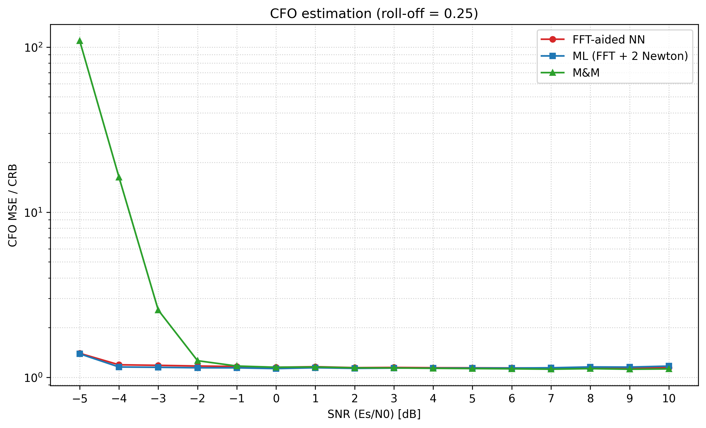

# CFO Estimation: Classical vs. Neural Estimators and Their Impact on BER

Carrier frequency offset (CFO) estimation for QPSK bursts. The project compares classical
estimators (Mengali & Morelli, ML, 4th power) with neural ones (expert MLP, fusion network,
SNR-aware MLP, FFT-aided MLP, channel-aware NN, 8-SPS coarse NN), and measures what the residual
CFO error costs in **uncoded** and **polar-coded (CA-SCL)** BER / BLER. It finishes with a
**zero-overhead burst receiver**: no preamble and no CP, with the CFO estimated blind and from the code.

The README has two parts that use **different channels**. Numbers from one part cannot be compared with the other:

| | Channel | Where the code and results live |
|---|---|---|
| **[Part A: AWGN](#part-a-awgn-channel)** | full Tx/Rx chain (RRC, CFO before the matched filter, AWGN), [A.1](#a1-signal-model-the-full-txrx-chain-txrx_chainpy); legacy sections symbol-rate ([A.0](#a0-status-full-txrx-chain-vs-legacy-results)) | main folder, plus `multipath/results_zo_awgn/`, `multipath/results_zo2_awgn*` (the `--channel awgn` runs) |
| **[Part B: Multipath](#part-b-multipath-channel-3-tap-rayleigh)** | 3 symbol-spaced Rayleigh taps (0 / −3 / −6 dB), block fading | `multipath/`, results in `multipath/results_*multipath*` |
| **[Part C: Conclusions](#part-c-conclusions-stage-4)** | both, side by side | |

Every multipath script takes `--channel awgn` and then reduces exactly to the AWGN model of
Part A, so the switch back is instant. Those AWGN runs are reported in Part A and validated against it.

**Bottom line**
* **AWGN, full Tx/Rx chain (A.1–A.5, verified).** A CFO of up to 0.2 Rs before the matched filter costs every
  receiver, even a Genie, up to 1.25 dB plus ISI, so all estimators sit at ≈ 1.12–1.17× the ideal CRB. ML is the
  best and cheapest estimator. The chain-retrained SNR-aware NN is 27× better than M&M at −5 dB but 2–8 % worse
  from −2 dB up, and in BLER the two are equal (R = 1/2) or M&M is 0.1 dB better (R = 1/4). A 128-symbol estimate
  leaves an error floor (BLER cliff at |e| ≈ 1e-4). Only a low-rate code at Es/N0 ≈ −4 dB would profit from the
  NN (its RMSE 5.3e-4 vs M&M 1.75e-3).
* **AWGN, zero-overhead receiver (A.7–A.8).** Blind 4th-power CFO estimation plus CRC selection of
  the ambiguity works, but only above the estimator's threshold (Es/N0 ≈ 3–4 dB). That costs 1.9 dB
  (R = 1/2) and 5.5 dB (R = 1/4) against a known CFO at BLER 1e-2.
* **Multipath (Part B).** Data-aided estimators that ignore the channel lose a lot; the joint CFO + taps
  ML (MP-ML) restores them at 3× the cost of ML, and an NN adds nothing over it. The blind
  zero-overhead receiver hits a **BLER floor of ≈ 0.45**, because the 4th-power estimate fails under ISI.
* **Stage 3 neural coarse estimator (8 SPS).** It learns the CFO cell, which is impossible at symbol rate.
  But as the first block of the receiver it is **worse than the classical 4th power + CRC in both channels**:
  +1.2 dB at BLER 1e-2 in AWGN and a higher floor in multipath, at ≈ 500× the MACs of the 4th-power stage
  ([A.8](#a8-stage-3-neural-coarse-cfo-estimator-8-sps), [B.5](#b5-stage-3-neural-coarse-estimator-in-multipath),
  [Part C](#part-c-conclusions-stage-4)).

---

## Repository layout

The Python code, `README.md` and `progress.txt` are in the project root. Every other file is in a folder by type,
and the scripts write there automatically (`paths.py`):

| Folder | Contents |
|---|---|
| `models/` | trained networks (`.pth`) |
| `results/` | simulation results and caches (`.npy`, `.npz`) |
| `logs/` | run logs, Run:ai job output `run_<job>.out`, progress files |
| `jobs/` | Run:ai job scripts (`.sh`) |
| `docs/` | the M&M paper |
| `plots/bler/`, `plots/ber/` | BLER and BER plots (vs Eb/N0, vs CFO error, uncoded BER) |
| `plots/mse/` | CFO MSE and MSE/CRB plots |
| `plots/outage/` | CFO outage probability |
| `plots/training/` | training curves |
| `multipath/` | Part B, with its own `results_*` folders (unchanged) |

| File | What it does |
|---|---|
| `paths.py` | Folder of every file type; `paths.plot(name)` picks the plot sub-folder from the file name |
| `config.py` | Global parameters (SPS = 8, RRC β = 0.25 / span 10, preamble L = 128, `MAX_CFO` = 0.2, SNR grid, run flags) |
| `channel.py` | Root-raised-cosine filter design |
| `main.py`, `plots.py` | Original Tx/Rx chain (upsample → RRC → CFO → AWGN → matched filter → downsample), MSE-vs-SNR / CFO-sweep / histogram experiments |
| `NN_model.py` | Training of the Phase-1 expert MLP (`best_cfo_model_L64.pth`) |
| `Hybrid.py` | Expert MLP, M&M, fusion network ("Model A"), `UnifiedHybridCFOEstimator` (`unified_hybrid_cfo_model.pth`) |
| `txrx_chain.py` | **The full Tx/Rx chain of `main.py`, vectorised**: used by every AWGN simulation and training set |
| `train_snr_nn.py` | SNR-aware MLP, CRB-normalised loss; data from the full chain (`snr_aware_cfo_model_L64_chain150.pth`; symbol-rate legacy `snr_aware_cfo_model_L64.pth`) |
| `train_nofft_nn.py` | FFT-free variants of the FFT-aided NN (`plain`, `unwrap`) |
| `train_fft_nn.py` | FFT-aided MLP (residual on the FFT bin), the ML estimator, complexity table (`fft_nn_residual_cfo_model_L64.pth`) |
| `plot_mse_crb_awgn.py` | MSE/CRB or MSE vs Es/N0 of selected estimators on the full chain (`--est`, `--metric`, `--beta`) |
| `train_fft_nn_long.py` | FFT-aided MLP, M&M and ML on a 512-symbol known sequence (`fft_nn_residual_cfo_model_seq512.pth`) |
| `ber_experiment.py` | Uncoded BER: 128-symbol preamble + payload through the full RRC chain |
| `polar.py` | Polar encoder + CRC-aided SCL decoder (batched NumPy, `decode(..., return_info=True)` also returns CRC flag and path metric) |
| `polar_ber_experiment.py` | Coded BER/BLER of a 512-symbol polar packet through the full chain: per estimator (Genie, SNR-aware NN, M&M) vs Eb/N0, and vs fixed CFO error |
| `job_progress.py` | Progress bars of every run (local or Run:ai) → `progress.txt` |
| **`multipath/`** | **Everything in Part B and the zero-overhead receiver (Stages 1–3)** |
| `multipath/multipath_cfo.py` | Data-aided M&M / ML / FFT-NN under multipath, L = 128 and 512 (`--channel awgn` / `multipath`) |
| `multipath/mp_cfo_v2.py` | Channel-aware estimators: MP-ML (joint CFO + taps) and MP-NN |
| `multipath/zero_overhead_rx.py` | Stage 1: zero-overhead receiver on AWGN (blind 4th power + CRC, code-aided refinement) |
| `multipath/zero_overhead_mp.py` | Stage 2: the same receiver with equalization (BCJR-MLSE / block MMSE, CMA or strongest-tap init, joint CFO + taps loop). `--channel awgn` reduces it to Stage 1. `--nn` adds the Stage 3 receivers |
| `multipath/coarse_nn.py` | Stage 3: 8-SPS neural coarse CFO estimator (front end, model, training, stand-alone evaluation) |
| `multipath/cluster.py` | Push / submit / sync helper for the Run:ai cluster (`bhn20`) |

---

# Part A: AWGN channel

## A.0 Status: full Tx/Rx chain vs. legacy results

**Every AWGN simulation now runs through the full Tx/Rx chain of `main.py`** (`txrx_chain.py`, A.1). There
is no symbol-rate shortcut. Sections not yet redone in the chain are marked **legacy (symbol-rate model)**.
Their *relative* conclusions still hold, but their absolute numbers are optimistic: the matched-filter loss of a
large CFO is missing.

| Section | Channel model | Status |
|---|---|---|
| A.3 estimators: MSE plots, SNR-aware NN | full chain | verified, retrained (A.3.2) |
| A.4 uncoded BER | full chain (`main.py` functions) | unchanged, estimators trained on the symbol-rate model |
| A.5 polar BER/BLER vs Eb/N0 and vs CFO error | full chain | verified, rerun |
| A.6 512-symbol estimation | symbol-rate | legacy |
| A.7–A.8 zero-overhead receiver, 8-SPS coarse NN | symbol-rate (A.8: idealised 8-SPS front end) | legacy |

## A.1 Signal model: the full Tx/Rx chain (`txrx_chain.py`)

QPSK symbols → upsample ×8 → RRC (β = `config.BETA` = 0.25 unless stated, span 10) → **CFO per sample, before
the matched filter**, ε ~ U[−0.2, 0.2] cycles/symbol, random carrier phase → AWGN with Es/N0 per symbol
(Es measured per frame as `main.apply_awgn`) → matched RRC → remove the filter delay → downsample.
The CRB is the data-aided bound var(ε̂) ≥ 3 / (2π² · SNR · L(L²−1)) (= `main.compute_cfo_crlb`).

**Verification of the chain** (independent checks, all passed):

| Check | Result |
|---|---|
| Vectorised chain vs `main.py` per-frame functions, same noise samples (ε = 0.137, 3 dB) | max difference 1.6e-15 |
| RRC: unit energy, Nyquist | energy 1.000000, raised cosine 1 at 0, ≤ 6.7e-3 at kT |
| Noise at the symbol instants (−5 and +10 dB) | variance 3.165 vs 1/SNR = 3.162; 0.10005 vs 0.1; lag-1 correlation ≤ 6e-3 |
| CFO phase reference of r[n] = 2πε(n + 5) + φ, matched-filter gain G(ε) = Σ h²[k] cos(2πεk/8) | measured 1.0000 / 0.9584 / 0.8686 vs theory 1.0000 / 0.9588 / 0.8684 at ε = 0 / 0.1 / 0.2, no phase error |
| Polar Genie with the CFO forced to 0 vs the old pure-AWGN Genie | 2.25e-3 vs 2.08e-3 (R=1/2, 2 dB), 2.48e-2 vs 2.42e-2 (R=1/4, 1 dB), within Monte-Carlo noise |
| BLER-vs-CFO-error run at e = 0 vs BLER-vs-Eb/N0 Genie (same seeds), 8 points | agree within Monte-Carlo noise (e.g. 5.57e-3 vs 5.65e-3, R=1/2, 3 dB) |
| ML vs brute-force periodogram (1e-5 grid); M&M vectorised vs `main.py` | median 3.1e-6; 5.9e-9 (float32 rounding) |
| Bias of M&M and SNR-aware NN across the CFO range (5 dB) | ≤ 4e-6, i.e. ≤ 3 % of √CRB |

**Consequence of the chain**: a CFO of up to 0.2 Rs shifts the signal partly out of the matched filter:
amplitude G(0.2) = 0.87 (−1.25 dB) plus ISI. Every receiver pays this, including a Genie that knows the CFO.
Genie BLER, R = 1/2 at Eb/N0 = 2.5 dB, at a fixed CFO: 0 (ε = 0 and 0.05), 1e-3 (0.1), 2.9e-2 (0.15),
0.37 (0.2). Averaged over ε ~ U[−0.2, 0.2] this gives 4.3e-2, against 3e-5 without the filter loss.

## A.2 How to run

```bash
python train_snr_nn.py --init snr_aware_cfo_model_L64.pth --tag _chain --epochs 40 --threads 8 --producers 7   # retrain on the chain
python plot_mse_crb_awgn.py                                                   # MSE/CRB: FFT-NN vs ML vs M&M
python plot_mse_crb_awgn.py --est "SNR-aware NN" "M&M" --metric mse --out mse_snr_aware_vs_mm_awgn.png
python plot_mse_crb_awgn.py --est "SNR-aware NN" "M&M" --metric mse --beta 0.5 --out mse_snr_aware_vs_mm_awgn_beta0p5.png
python polar_ber_experiment.py --mode ebn0  --workers 16 --min-errors 500 --max-frames 100000
python polar_ber_experiment.py --mode error --workers 16 --min-errors 1000 --max-frames 200000
python polar_ber_experiment.py --mode error --plot-only                       # redraw (RMSE lines cached in cfo_rmse_chain.npz)
python ber_experiment.py --frames 4000 --payload 1024                         # uncoded BER (A.4)
python job_progress.py                                                        # progress bars → progress.txt
```

Long runs go to Run:ai (16 cores) with `multipath/cluster.py`. `OMP_NUM_THREADS=1` in multi-process scripts.

## A.3 CFO estimators (known 128-symbol sequence)

| Estimator | How it works | Real MACs / estimate | Params |
|---|---|---|---|
| **M&M** (Mengali & Morelli) | Lag correlations R(m), m = 1..64; weighted sum of the phase increments arg(R(m)R*(m−1)) | 24,704 | 0 |
| **ML** | 256-point FFT periodogram peak + 2 Newton steps | **7,168** | 0 |
| **Expert NN** | MLP 256→128→64→32→1 (GELU) on [Re, Im, \|·\|, arg] of R(m) | 67,488 | 43,265 |
| **Fusion** ("Hybrid") | Expert NN + M&M; a small net outputs w, estimate = w·NN + (1−w)·M&M | 70,448 | 46,086 |
| **SNR-aware NN** | Expert MLP + true SNR input, loss = error² / CRB(SNR); **retrained on the full chain** (A.3.2) | 67,616 | 43,393 |
| **FFT-aided NN** | SNR-aware MLP + 8 periodogram-peak features; residual on the FFT bin | 72,736 | 44,417 |

**M&M is implemented exactly as in the paper** (Mengali & Morelli 1997, eqs. (3), (8), (9); N = L₀/2 = 64). All
four copies in the repo agree, and the vectorised version equals `main.py`'s to 6e-9 (float32 rounding).
The only difference: the paper's own simulations use the multiplication-free R̄(m) of its eq. (10); we use the
exact R(m) of eq. (3), which is better, e.g. MSE/CRB 15 vs 114 at Es/N0 = −5 dB (symbol-rate check). The paper's
axis is Eb/N0 = Es/N0 − 3 dB; it shows results only from Eb/N0 = 0 dB (Es/N0 = 3 dB) up.

**MSE/CRB on the full chain** (β = 0.25). M&M, ML, FFT-aided NN: 1,000,000 frames per point at ≤ −3 dB and
100,000 above ([`mse_over_crb_awgn.png`](plots/mse/mse_over_crb_awgn.png)). SNR-aware NN: the same frame counts
(`mse_snr_aware_vs_mm_awgn.png`). Expert and Fusion: the 20,000-frame test of `train_snr_nn.py`.

| Es/N0 (dB) | −5 | −4 | −3 | −2 | 0 | 5 | 10 |
|---|---|---|---|---|---|---|---|
| ML | **1.39** | **1.15** | **1.15** | **1.14** | **1.13** | 1.14 | 1.17 |
| FFT-aided NN (symbol-rate trained) | 1.40 | 1.19 | 1.18 | 1.17 | 1.15 | 1.14 | 1.14 |
| SNR-aware NN (retrained on the chain) | 4.08 | 1.70 | 1.36 | 1.28 | 1.20 | 1.16 | 1.16 |
| Fusion | 7.7 | 1.40 | 1.28 | 1.20 | 1.18 | 1.12 | 1.13 |
| Expert NN | 7.3 | 1.71 | 1.52 | 1.41 | 1.34 | 1.32 | 1.66 |
| M&M | 109 | 16.3 | 2.55 | 1.26 | 1.15 | **1.13** | **1.12** |

* **In the full chain no estimator reaches the CRB**: all sit at ≈ 1.12–1.17 × CRB from −2 dB up. That is the
  matched-filter loss of A.1, and the CRB here is the ideal one, without filter loss.
* **ML is the best estimator at every SNR up to ≈ 3 dB** and the cheapest (7.2k MACs). M&M is marginally best from
  4 dB (1–3 %, invisible in BER/BLER). **M&M breaks down below −3 dB** (×109 the CRB at −5 dB).
* **The MSE at −5 / −4 dB is outlier-dominated**: the 20 worst of 100,000 trials carry 45–80 % of the MSE, and a
  100,000-trial MSE varies ×2.5 between seeds. Hence 10⁶ trials there. The "1e-5" M&M MSE at −5 dB of the original
  `main.py` plots is this full-chain regime: 2.5e-5 at β = 0.25, 1.1e-5 at β = 0.5.

### A.3.1 The FFT-aided NN in detail (`train_fft_nn.py`, checkpoint `fft_nn_residual_cfo_model_L64.pth`)

**Idea.** The lag-correlation features the earlier NNs use break down at low SNR, the same threshold as
M&M. The periodogram peak (the ML coarse estimate) does not. So the network gets the FFT peak and its
neighbourhood, and only learns a **residual inside the peak bin**.

**Inputs** (computed from z[n] = r[n]·s*[n], n = 0..127, which removes the known QPSK symbols): **265 values**
| Group | Size | What |
|---|---|---|
| Lag features | 64 × 4 = 256 | R(m) = (1/(L−m)) Σ_n z[n]·z*[n−m], m = 1..64 (M = L/2 lags, as M&M); for each lag [Re R(m), Im R(m), \|R(m)\|, arg R(m)] |
| SNR | 1 | true Es/N0 in dB, scaled as (SNR − 2.5)/7.5, so [−5, 10] dB maps to [−1, 1] |
| FFT features | 8 | X = FFT₂₅₆(z), peak bin k searched over \|f\| ≤ 0.2: [f_c/0.2, \|X[k−1]\|/L, \|X[k]\|/L, \|X[k+1]\|/L, Re/Im(X[k−1]X*[k]/\|X[k]\|²), Re/Im(X[k+1]X*[k]/\|X[k]\|²)]: the coarse frequency, the peak and neighbour magnitudes, and the neighbour-to-peak complex ratios that bin interpolators use |

**Architecture.** MLP 265 → 128 → 64 → 32 → 1, GELU activations, **44,417 parameters**.
**Output**: ε̂ = f_c + (1 bin) · MLP(·), with one bin = 1/256 cycles/symbol. The last layer is zero-initialised,
so training starts exactly at the FFT-peak estimate.

**Training** (legacy: symbol-rate model, not retrained). ε ~ U[−0.2, 0.2], Es/N0 ~ U[−6, 11] dB, batch 1024 ×
500 steps × 150 epochs, AdamW (3e-4, cosine decay), loss = mean(error² / CRB(Es/N0, 128)). It still transfers
to the full chain (table above: within 1–3 % of ML).

**Complexity per estimate** (real multiply-accumulates; 1 complex MAC = 4 real):
| Part | real MACs |
|---|---|
| 64 lag correlations (direct, Σ_{m=1..64}(128−m) = 6,112 complex MACs) | 24,448 |
| FFT 256 (radix-2, 1,024 complex MACs) | 4,096 |
| MLP (265·128 + 128·64 + 64·32 + 32·1) | 44,192 |
| **Total FFT-aided NN** | **72,736** |
| ML (FFT 256 + 2 Newton steps × 3 sums over 128) for comparison | 7,168 |
| M&M (64 lag correlations + weighted phase sum) for comparison | 24,704 |

So the FFT-aided NN costs **10× ML** and **2.9× M&M**, plus 44k stored weights, and needs the SNR.
Removing its 8 FFT features gives exactly the SNR-aware NN's input. An FFT-free variant that replaces the
FFT peak by a lag-doubling phase-unwrapping coarse estimate (`train_nofft_nn.py`, `unwrap`) matched the
FFT-aided NN in validation (mean MSE/CRB 1.022 vs 1.035; legacy symbol-rate, 5,000 trials per point).



### A.3.2 SNR-aware NN, retrained on the full chain (`train_snr_nn.py`)

* **Input**: the 64 × 4 lag features + SNR (257 values). **Architecture**: MLP 257 → 128 → 64 → 32 → 1 (GELU),
  43,393 parameters, 67,616 real MACs per estimate (lags 24,448 + MLP 43,168).
* **Training data**: `make_z` now draws every batch from the full chain (`txrx_chain.known_sequence`), ε ~ U[−0.2, 0.2],
  Es/N0 ~ U[−6, 11] dB, loss = error²/CRB. Fine-tuned from the symbol-rate model: 40 epochs, then 150 more
  (500 × 1024 frames per epoch, AdamW 3e-4 cosine; Run:ai, 16 cores, 7 data-producer processes, ≈ 25 min).
  Checkpoint `snr_aware_cfo_model_L64_chain150.pth`; the symbol-rate one is kept as `snr_aware_cfo_model_L64.pth`.
* Effect of retraining (MSE/CRB on the chain, β = 0.25): **≈ 12 → 4.1 at −5 dB**, ≈ 2.7 → 1.70 at −4 dB,
  1.26 → 1.20 at 0 dB.

**MSE vs SNR, SNR-aware NN vs M&M, with the CRB** ([`mse_snr_aware_vs_mm_awgn.png`](plots/mse/mse_snr_aware_vs_mm_awgn.png)
roll-off 0.25, [`mse_snr_aware_vs_mm_awgn_beta0p5.png`](plots/mse/mse_snr_aware_vs_mm_awgn_beta0p5.png) roll-off 0.5;
10⁶ frames per point at ≤ −3 dB, 10⁵ above; × = MSE/CRB):

| Es/N0 | −5 | −4 | −3 | −2 | 0 | 10 dB |
|---|---|---|---|---|---|---|
| SNR-aware NN, β = 0.25 | **9.3e-7** (4.1×) | **3.1e-7** (1.7×) | **2.0e-7** (1.36×) | 1.47e-7 | 8.7e-8 (1.20×) | 8.4e-9 (1.16×) |
| M&M, β = 0.25 | 2.5e-5 (109×) | 3.0e-6 (16×) | 3.7e-7 (2.6×) | **1.45e-7** | **8.3e-8** (1.15×) | **8.1e-9** (1.12×) |
| SNR-aware NN, β = 0.5 | **5.8e-7** (2.5×) | **2.6e-7** (1.45×) | **1.85e-7** (1.28×) | 1.40e-7 | 8.3e-8 (1.15×) | 8.1e-9 (1.12×) |
| M&M, β = 0.5 | 1.1e-5 (48×) | 1.1e-6 (6.2×) | 2.0e-7 (1.40×) | **1.29e-7** | **7.9e-8** (1.10×) | **7.8e-9** (1.07×) |
| CRB | 2.3e-7 | 1.8e-7 | 1.45e-7 | 1.15e-7 | 7.2e-8 | 7.2e-9 |

* The SNR-aware NN is **27× (β = 0.25) / 19× (β = 0.5) better than M&M at −5 dB** and ≈ 10× / 4× at −4 dB.
  From −2 dB up M&M is 2–8 % better.
* β = 0.5 widens the matched filter, so less of the frequency-shifted signal is lost: every estimator moves
  closer to the CRB (M&M 1.07–1.10× from 0 dB up, vs 1.12–1.15× at β = 0.25), and M&M's breakdown is ≈ 2.5× milder.

## A.4 Uncoded BER (`ber_experiment.py`)

128-symbol preamble + 1024 (or 256) payload symbols through the full RRC chain, random phase;
de-rotate with the CFO estimate, phase from the preamble, hard QPSK decisions. (Estimators here are the
symbol-rate-trained versions.)

| Es/N0 | QPSK theory | Genie | Known CFO | Hybrid | ML | FFT-aided NN |
|---|---|---|---|---|---|---|
| 0 dB, P=1024 | 0.159 | 0.160 | 0.174 | 0.313 | 0.311 | 0.314 |
| 10 dB, P=1024 | 7.8e-4 | 8.0e-4 | 3.0e-3 | 4.2e-2 | 4.4e-2 | 4.3e-2 |
| 10 dB, P=256 | 7.8e-4 | 8.2e-4 | 3.0e-3 | 4.8e-3 | 4.9e-3 | 4.8e-3 |

With a long payload all estimators give the same BER, far above Known CFO: over 1024 symbols even a
CRB-level error rotates the phase by ~0.6 rad at 10 dB. The payload length, not the estimator, sets the BER.

## A.5 Polar-coded BER / BLER, full chain (`polar.py`, `polar_ber_experiment.py`)

**Code and decoder.** 512 QPSK symbols = one polar codeword, N = 1024 coded bits. R = 1/2 (512 data bits +
CRC-11) and R = 1/4 (256 + CRC-11); R = 1/10 (102 + CRC-11) only in the CFO-error sweep. 5G NR CRC, PW
construction, fixed random interleaver. CA-SCL, list 8, min-sum, rate-0 shortcut, batched float32.
**Eb/N0** counts the CRC as overhead: Es/N0 = Eb/N0 + 10·log10(A/512) (R = 1/2: equal; R = 1/4: −3.01 dB;
R = 1/10: −7.01 dB).

**Channel and receiver.** Every packet goes through the full chain (A.1) with its own random ε ~ U[−0.2, 0.2] and
phase. The CFO estimate ε̂ comes from the source:
* **Genie**: ε̂ = ε (true CFO; still pays the matched-filter loss).
* **SNR-aware NN** (chain-trained) and **M&M**: estimated on the packet's first 128 received symbols, treated as
  known (a 128-symbol training sequence), same chain and noise as the data.
* **CFO-error sweep**: ε̂ = ε + e for a fixed |e| with random sign.

The packet is de-rotated by ε̂ with the phase reference exact at the packet centre, so the residual phase is
2π(ε − ε̂)(n − 255.5). Then LLRs → de-interleave → CA-SCL. All sources see the same data, CFO, phase and noise.

**BLER vs Eb/N0** ([`polar_bler_vs_ebn0_R0p5.png`](plots/bler/polar_bler_vs_ebn0_R0p5.png), [`_R0p25.png`](plots/bler/polar_bler_vs_ebn0_R0p25.png), [`polar_ber_vs_ebn0.png`](plots/ber/polar_ber_vs_ebn0.png);
up to 100,000 frames and ≥ 500 errors per point; `polar_results_ebn0_chain.npy`):

| Eb/N0 for BLER | 0.3 | 0.1 | 0.03 | 0.01 | 1e-3 |
|---|---|---|---|---|---|
| R=1/2 Genie | 1.62 dB | 2.18 dB | 2.59 dB | 2.86 dB | 3.33 dB |
| R=1/2 SNR-aware NN | 2.08 | 2.83 | 3.52 | 4.09 | 5.16 |
| R=1/2 M&M | 2.08 | 2.82 | 3.49 | 4.06 | 5.12 |
| R=1/4 Genie | 0.82 | 1.31 | 1.74 | 2.03 | 2.56 |
| R=1/4 SNR-aware NN | 1.51 | 2.45 | 3.26 | 4.03 | 5.13 |
| R=1/4 M&M | 1.44 | 2.37 | 3.20 | 3.94 | 5.10 |

Both rates are simulated over Es/N0 −5 … 10 dB (both packet lengths). Points with no error in 30,000 frames
(BLER < 3.3e-5) are left out of the plots: the Genie from Es/N0 ≈ 3.75 dB (R = 1/2) and ≈ 0.5 dB (R = 1/4), the
estimators from ≈ 7.5 / 4 dB.

* **SNR-aware NN ≈ M&M**: within 0.03 dB for R = 1/2, M&M ≈ 0.05–0.1 dB better for R = 1/4 (Es/N0 −2 … 1 dB, where
  M&M's MSE is 2–8 % lower). The NN's low-SNR advantage (−5/−4 dB) is below where these codes work.
* **Both lose ≈ 0.65 dB to the Genie at BLER 0.1, growing to ≈ 1.8 dB (R = 1/2) and 2.5 dB (R = 1/4) at 1e-3.**
  The cause is the 128-symbol estimate's error, as in the legacy study. It is not the estimator: see the CFO-error sweep.
* **L = 128 packet** ([`polar_bler_vs_ebn0_R0p5_L128.png`](plots/bler/polar_bler_vs_ebn0_R0p5_L128.png),
  [`_R0p25_L128.png`](plots/bler/polar_bler_vs_ebn0_R0p25_L128.png); N = 256, A = 128 / 64, CFO estimated on the
  whole packet): both estimators lie on the Genie curve. Across 128 symbols the phase drift of the residual CFO
  is too small to matter.

**BLER vs fixed CFO error** (`polar_{ber,bler}_vs_cfo_error_R0p5.png`, `_R0p25.png`; R = 1/10 only in the table below, no plot; up to 200,000
frames and ≥ 1,000 errors per point; `polar_results_error_chain.npy`). Dotted lines: the RMSE of M&M (1.75e-3) and of
the SNR-aware NN (5.27e-4) at **SNR = Es/N0 = −4 dB**, 10⁶ frames (`cfo_rmse_chain.npz`):

| \|e\| (cycles/symbol) | 0 | 5.7e-5 | 1.0e-4 | 1.8e-4 | 3.3e-4 | 5.9e-4 | ≥ 1.1e-3 |
|---|---|---|---|---|---|---|---|
| R=1/2, Eb/N0 2.5 dB | 4.3e-2 | 4.7e-2 | 5.7e-2 | 9.9e-2 | 0.38 | 1.0 | 1.0 |
| R=1/2, Eb/N0 3.0 dB | 5.6e-3 | 6.6e-3 | 8.8e-3 | 2.2e-2 | 0.17 | 1.0 | 1.0 |
| R=1/4, Eb/N0 2.0 dB | 1.2e-2 | 1.3e-2 | 1.5e-2 | 2.5e-2 | 0.10 | 0.80 | 1.0 |
| R=1/10, Es/N0 −5 dB | 9.8e-3 | 1.0e-2 | 1.2e-2 | 1.6e-2 | 4.3e-2 | 0.35 | 1.0 |
| R=1/10, **Es/N0 −4 dB** | 1.8e-4 | 1.8e-4 | 2.2e-4 | 3.5e-4 | 1.8e-3 | 6.5e-2 | 1.0 |

* The coded BLER is flat up to |e| ≈ 5e-5 … 1e-4 and collapses within less than a factor of 10 in e; it is
  1.0 from ≈ 6e-4 (R = 1/2) to ≈ 1.1e-3 (R = 1/10). **|e| ≈ 1e-4 stays the outage threshold.**
* **At SNR −4 dB the SNR-aware NN's RMSE (5.3e-4) sits at the knee** of the R = 1/10 curve (BLER ≈ 6e-2 at
  5.9e-4). **M&M's RMSE (1.75e-3) is far past the cliff**: BLER 1. This is the one place where the NN's low-SNR
  advantage would matter, for a low-rate code operated at Es/N0 ≈ −4 dB.

## A.6 Estimating the CFO on the whole 512-symbol packet (`train_fft_nn_long.py`)

> **Legacy (symbol-rate model)**: not yet redone in the full chain; absolute numbers are optimistic (A.0).

Same packets, but the estimators see the 512 packet symbols as known (the upper bound of
decision-directed estimation). M&M with M = 256 lags; FFT-aided NN fine-tuned for L = 512 (1.03×CRB).

| Es/N0 | M&M L=128 | FFT-NN L=128 | M&M L=512 | ML L=512 | FFT-NN L=512 |
|---|---|---|---|---|---|
| −5 dB | 1.6e-3 (11.6×CRB) | 5.0e-4 (1.09) | 6.1e-5 (1.03) | 6.0e-5 (1.02) | 6.1e-5 (1.05) |
| 0 dB | 2.7e-4 (1.04) | 2.7e-4 (1.04) | 3.4e-5 (1.01) | 3.4e-5 (1.03) | 3.4e-5 (1.04) |
| 10 dB | 8.5e-5 (1.00) | 8.6e-5 (1.02) | 1.1e-5 (1.02) | 1.2e-5 (1.22) | 1.1e-5 (1.05) |

Complexity (real MACs): M&M 24,704 / 393,728 (direct) or 8,448 / 41,984 (FFT autocorrelation);
ML 7,168 / 32,768; FFT-aided NN 72,736 / 187,424 (L = 128 / 512).

Eb/N0 for a target BLER ([`polar_bler_vs_ebn0_L128_vs_L512_R0p5.png`](plots/bler/polar_bler_vs_ebn0_L128_vs_L512_R0p5.png), `_R0p25.png`):

| Code | CFO source | BLER 1e-1 | BLER 1e-2 | BLER 1e-3 |
|---|---|---|---|---|
| R=1/2 | Genie | 1.32 dB | 1.77 dB | 2.11 dB |
| R=1/2 | M&M / FFT-NN, 128 symbols | 2.06 / 2.08 | 3.30 / 3.32 | > 3.5 |
| R=1/2 | M&M / FFT-NN, 512 symbols | 1.33 / 1.33 | 1.76 / 1.76 | 2.10 / 2.10 |
| R=1/4 | Genie | 0.61 | 1.20 | 1.63 |
| R=1/4 | M&M / FFT-NN, 128 symbols | 1.80 / 1.81 | > 3.0 | > 3.0 |
| R=1/4 | M&M / FFT-NN, 512 symbols | 0.61 / 0.61 | 1.17 / 1.17 | 1.55 / 1.56 |

**With a 512-symbol estimate the error floor disappears**, with either estimator. But the receiver
does not know the 512 symbols, which is what the zero-overhead receiver below has to solve.

## A.7 Zero-overhead receiver, Stage 1: AWGN (`multipath/zero_overhead_rx.py`)

> **Legacy (symbol-rate model)**: not yet redone in the full chain (A.0).

**Packet**: the polar packet of A.5 (512 QPSK symbols, R = 1/2 or 1/4, CA-SCL L = 8), **no preamble,
no CP**, 2-symbol guard. ε ~ U[−0.2, 0.2], random phase. The receiver knows Es/N0 and has perfect timing.

**Receivers (same packets, common random numbers)**
| Receiver | What it does |
|---|---|
| Genie | true ε and φ |
| Known 512 | data-aided ML (FFT 1024 + 2 Newton) on the true 512 symbols (the known-symbol bound) |
| **Blind + CRC** (Algorithm 1) | 4th power: FFT of y⁴ (K = 2048) + 2 Newton → f0 = ν/4, φ0 from the same line. Ambiguities: CFO mod 1/4 (cells k = −1, 0, 1 inside the ±0.2 prior) and phase mod π/2. **Every (k, phase) hypothesis is decoded** (≈7.1 decodes/packet); the CRC-passing one with the best path metric wins |
| Code-aided 1/2/3 (Algorithm 2) | re-encode the decision → data-aided ML of ε, φ on it → decode again; 1–3 iterations |
| Oversampled cell (no decoding) | RRC chain at 8 SPS, cell k from the 4th-power line searched over ±0.8 Rs |

Monte Carlo: 0.5 dB Es/N0 grid, 10,000 packets per point (100,000 where BLER < 1e-2), ≥ 200 errors.
Plots: [`zo_bler_vs_ebn0.png`](multipath/results_zo_awgn/zo_bler_vs_ebn0.png),
[`zo_ber_vs_ebn0.png`](multipath/results_zo_awgn/zo_ber_vs_ebn0.png),
[`zo_cfo_metrics_R0p5.png`](multipath/results_zo_awgn/zo_cfo_metrics_R0p5.png), `zo_cfo_metrics_R0p25.png`.

**Eb/N0 for a target BLER (AWGN)**

| Code | Genie | Known 512 | Blind + CRC = Code-aided 3 | Loss vs Genie |
|---|---|---|---|---|
| R=1/2, BLER 1e-2 | 1.77 dB | 1.75 dB | 3.62 dB | 1.85 dB |
| R=1/2, BLER 1e-3 | 2.11 dB | 2.10 dB | 4.15 dB | 2.0 dB |
| R=1/4, BLER 1e-2 | 1.19 dB | 1.17 dB | 6.65 dB | 5.5 dB |
| R=1/4, BLER 1e-3 | 1.63 dB | 1.55 dB | 7.16 dB | 5.5 dB |

**CFO and ambiguity statistics (R = 1/2; R = 1/4 identical at the same Es/N0)**

| Es/N0 | 4th power (k = 0): median / P(>1e-4) | Blind + CRC | Code-aided 3 | Known 512 median | cell k wrong (CRC) | cell k wrong (oversampled spectrum) |
|---|---|---|---|---|---|---|
| 1 dB | 8.9e-2 / 0.85 | 6.6e-2 / 0.77 | 8.0e-2 / 0.80 | 2.1e-5 | 0.34 | 0.33 |
| 2 dB | 4.9e-2 / 0.65 | 8.0e-5 / 0.44 | 3.3e-5 / 0.36 | 1.8e-5 | 0.16 | 0.28 |
| 3 dB | 8.0e-5 / 0.46 | 3.8e-5 / 0.13 | 1.8e-5 / 0.06 | 1.6e-5 | 0.028 | 0.22 |
| 4 dB | 5.4e-5 / 0.39 | 2.8e-5 / 0.022 | 1.5e-5 / 0.002 | 1.5e-5 | 0.001 | 0.15 |
| 6 dB | 3.4e-5 / 0.37 | 1.8e-5 / 0.000 | 1.2e-5 / 0.000 | 1.2e-5 | 0 | 0.05 |
| 10 dB | 1.7e-5 / 0.38 | 8.8e-6 / 0.000 | 7.6e-6 / 0.000 | 7.6e-6 | 0 | 0.012 |

(The "k = 0" column stays at P ≈ 0.37 at high SNR simply because 37 % of the CFOs are in another cell.)

**Observations**
* The blind receiver is limited by the **4th-power threshold at Es/N0 ≈ 3–4 dB**, not by the code: below
  it the r⁴ line is buried (the 4th power raises the noise to the 4th order). Hence the loss is small for
  R = 1/2 (its own threshold is at ≈1.8 dB) and large for R = 1/4 (the code works from Es/N0 ≈ −2 dB).
* **CRC selection resolves the ambiguity essentially perfectly** above the threshold (cell error 1e-3 at
  4 dB, 0 above). The oversampled-spectrum cell decision is far worse (15 % wrong at 4 dB), because the
  line's symbol-rate harmonic at 4ε ± 1 is also inside the ±0.8 search window.
* **Code-aided refinement brings the CFO to the known-symbol bound** (median equal to Known 512 from
  4 dB), but gives **no BLER gain**: when the first decode succeeds the CFO is already good enough, and
  when it fails the re-encoded decision is wrong.
* **Complexity**: 4th-power stage ≈ 64k real MACs (y⁴, FFT 2048, 2 Newton); ≈7.1 CA-SCL decodes per
  packet for the hypotheses + 1 per code-aided iteration (vs. 1 for a known CFO). The decodes dominate.

## A.8 Stage 3: neural coarse CFO estimator (8 SPS)

> **Legacy**: idealised 8-SPS front end (CFO applied after the matched filter), not the `main.py` chain (A.0).

Code: `multipath/coarse_nn.py`.

The NN replaces Algorithm 1 (the 4th-power stage) as the first block of the receiver. It is trained on
AWGN and multipath together (p = 0.5); the AWGN results are here, the multipath results in [B.5](#b5-stage-3-neural-coarse-estimator-in-multipath).

**Why 8 SPS (first attempt at symbol rate failed).** The first network took the symbol-rate burst
(2 × 512) and |FFT(r⁴)|. Its cell error stayed at the prior P(k ≠ 0) = 0.37 for 40 epochs
(`results_coarse_nn/train_symrate.log`). A CFO shift of 1/4 multiplies symbol n by jⁿ, which maps a random
QPSK burst onto another equally likely QPSK burst. **At symbol rate the cell is unidentifiable: no network
can learn it.** It is the same ambiguity the 4th power has. Between the symbol instants the shift also
moves the pulse spectrum by Rs/4, so the **oversampled** matched-filter output resolves it: the 4th-power line
at 4ε is unambiguous over ±4 Rs at 8 SPS.

**Front end (`waveform`).** Symbols → symbol-spaced channel → RRC (β 0.25, span 10, 8 SPS) → + white noise →
matched RRC. The CFO rotation is applied to the signal after the matched filter (CFO small against the
filter bandwidth). The noise is the matched-filtered white noise, not rotated, so its spectrum stays at 0.
Every 8th sample is then exactly the symbol-rate burst of Stages 1–2 (checked: noise variance 0.1001 for
0.1, lag-1 correlation 1e-4), so the decoding receivers are unchanged and the NN additionally sees z8.
(Rotating the noise too would have centred the noise hump on the CFO and let the NN cheat at low SNR.)

**Inputs** (z8: 514 × 8 = 4112 samples, unit RMS)
* z8 real / imag (2 × 4112)
* |FFT₁₆₃₈₄(z8⁴)| cropped to |4ε| ≤ 0.81 (3317 bins of 1/2048 cycles/symbol), unit energy, log-compressed
* a zoom: |DTFT(z8⁴)| at the spectrum peak ν_pk ± 4 bins in quarter-bin steps (33 values), and ν_pk itself

**Architecture** (974,820 parameters)
* CNN on z8: 4 × [Conv1d(kernel 7, stride 2) + GELU], 32/32/64/64 channels, global average pooling → 64
* MLP on the spectrum 3317 → 256 → 128; MLP on the zoom 33 → 64 → 32
* head: concat(64 + 128 + 32 + 1) → 128 → 64 → 4 = 3 logits for the cell k + a residual ρ (|ρ| ≤ 4 bins)
* output: 4ε̂ = ν_pk + ρ/2048, ε_fine = 4ε̂/4 wrapped to [−1/8, 1/8), ε̂ = k/4 + ε_fine; optional
  **polish** = 2 Newton steps on the symbol-rate r⁴ periodogram from ε_fine

**Training** (on the fly, Run:ai, 16 cores, ≈25 min): polar-coded bursts (R = 1/2 or 1/4), AWGN or 3-tap
Rayleigh (p = 0.5), ε ~ U[−0.2, 0.2], φ ~ U[0, 2π), Es/N0 ~ U[−6, 11] dB; 40 epochs × 400 batches × 256.
Loss = CE(k) + 0.3 · log(1 + e²/CRB(Es/N0, 512)), with e the fine error, counted only where the peak is within
4 bins of the true line (elsewhere no residual can fix it). AdamW + OneCycle (1e-3).

**Receiver with the NN** (`zero_overhead_mp.py --nn`): hypotheses = the 2 most probable cells (inside the
prior) × 4 phase relabellings, then the same equalizer, CRC selection and code-aided loop as Algorithm 1.

**Training curve** (`results_coarse_nn/train.log`, validation 1,000 bursts per point): the cell error of the
k head fell from the prior 0.37 to **0.026 / 0.014 / 0.001 / 0.002 at Es/N0 = −5 / 0 / 5 / 10 dB (AWGN)**. The
classical oversampled-peak cell decision gets 0.28 / 0.21 / 0.002 / 0. So 8 SPS makes the cell learnable,
and the NN finds it far below the 4th-power threshold.

**Stand-alone CFO accuracy, AWGN** (`coarse_nn.py --eval`, 20,000 bursts per point,
[`coarse_nn_vs_4th_power.png`](multipath/results_coarse_nn/coarse_nn_vs_4th_power.png); P(|err| > 1e-4)):

| Es/N0 | 4th power, k = 0 | 4th power + oversampled cell | 4th power, oracle k | NN | NN + polish |
|---|---|---|---|---|---|
| 0 dB | 0.952 | 0.934 | 0.923 | 0.964 | 0.962 |
| 2 dB | 0.653 | 0.486 | 0.437 | 0.719 | 0.695 |
| 3 dB | 0.456 | 0.170 | 0.131 | 0.416 | 0.376 |
| 4 dB | 0.385 | 0.032 | 0.022 | 0.156 | 0.106 |
| 5 dB | 0.380 | 0.004 | 0.004 | 0.041 | 0.016 |
| 10 dB | 0.382 | 0.000 | 0.000 | 0.002 | 0.002 |

The NN gets the cell right, but its **fine** estimate is worse than the plain symbol-rate 4th power. At low
SNR the fine part is random inside the cell (median 0.07), because nothing can beat the r⁴ threshold. Around
the threshold, the peak of the oversampled spectrum (weaker line, plus harmonics) is a worse starting point than the
symbol-rate FFT peak, and the Newton polish only climbs to the nearest local maximum. Its 0.2 % high-SNR floor
is k-head mistakes.

**In the receiver, AWGN** (`zero_overhead_mp.py --channel awgn --nn`, 4,000–20,000 packets per point, all
receivers on the same 8-SPS packets; [`zo_bler_vs_ebn0.png`](multipath/results_zo2_awgn_nn/zo_bler_vs_ebn0.png)):

| Eb/N0 for BLER | Genie | 4th power + CRC, code-aided 3 | NN + CRC, code-aided 3 | NN loss |
|---|---|---|---|---|
| R=1/2, 1e-1 | 1.24 dB | 2.77 dB | 3.85 dB | +1.1 dB |
| R=1/2, 1e-2 | 1.73 dB | 3.56 dB | 4.81 dB | +1.25 dB |
| R=1/4, 1e-1 | 0.51 dB | 5.75 dB | 6.84 dB | +1.1 dB |
| R=1/4, 1e-2 | 1.19 dB | 6.54 dB | 7.78 dB | +1.25 dB |

Hypothesis decodes per packet: NN 5.8 (top-2 cells inside the prior × 4 phases) vs 4th power 6.9 (every valid
cell × 4 phases), both + 3 code-aided decodes. The classical numbers reproduce Stage 1 (3.56 vs 3.62 dB at
1e-2 for R = 1/2), which confirms the 8-SPS front end.

---

# Part B: Multipath channel (3-tap Rayleigh)

> **Everything in this part uses the multipath channel.** r[n] = e^{j(2πεn+φ)} Σ_k h_k s[n−k] + w[n],
> 3 symbol-spaced taps with power-delay profile 0 / −3 / −6 dB, independent Rayleigh taps,
> **one realisation per burst** (block fading), E[Σ|h_k|²] = 1, so **Es/N0 is the average received SNR**.
> Numbers here are not comparable with Part A, except where a table explicitly shows both.
> All scripts accept `--channel awgn`, which makes h = [1] and reproduces Part A.

## B.1 How to run

```bash
python multipath/multipath_cfo.py --channel multipath          # M&M / ML / FFT-NN, L = 128 and 512
python multipath/mp_cfo_v2.py ...                              # MP-ML and MP-NN (train + evaluate)
python multipath/zero_overhead_mp.py --channel multipath --parts 4 --part 0      # Stage 2, one job per part
python multipath/zero_overhead_mp.py --channel multipath --refs-only --parts 4 --part 0   # high-trial references
python multipath/zero_overhead_mp.py --channel multipath --merge
python multipath/coarse_nn.py --train ; python multipath/coarse_nn.py --eval          # Stage 3 NN
python multipath/zero_overhead_mp.py --channel multipath --nn multipath/results_coarse_nn/coarse_nn.pth --parts 8 --part 0
```
Results: `multipath/results_multipath/` (B.2–B.3), `multipath/results_zo2_multipath/` (Stage 2),
`multipath/results_coarse_nn/` and `multipath/results_zo2_multipath_nn/` (Stage 3).

## B.2 How much multipath degrades known-sequence CFO estimation (`multipath_cfo.py`)

Same estimators as Part A, on z[n] = r[n]·s*[n] with a known sequence. The delayed taps now act as
interference (ISI) and the main tap fades. "Channel-trained" FFT-NN = fine-tuned on this channel.
20,000 sequences per point. [`cfo_outage_multipath.png`](multipath/results_multipath/cfo_outage_multipath.png),
`cfo_rmse_multipath.png`, `cfo_median_multipath.png`.

**P(|CFO error| > 1e-4), multipath**

| Es/N0 | M&M L=128 | ML L=128 | M&M L=512 | ML L=512 | FFT-NN L=512 (AWGN-trained) | FFT-NN L=512 (channel-trained) |
|---|---|---|---|---|---|---|
| −5 dB | 0.94 | 0.91 | 0.53 | 0.38 | 0.40 | 0.39 |
| 0 dB | 0.86 | 0.84 | 0.29 | 0.21 | 0.26 | 0.22 |
| 5 dB | 0.78 | 0.77 | 0.17 | 0.13 | 0.22 | 0.13 |
| 10 dB | 0.72 | 0.71 | 0.13 | 0.09 | 0.21 | 0.10 |

For comparison, in AWGN at L = 512 the outage is ≈0 from −5 dB up (A.6). The RMSE is dominated by gross
errors (≈2e-2 at L = 512, 3e-2 at L = 128, independent of SNR): in deep fades of the main tap the ISI
terms produce spurious periodogram peaks. **Training the NN on the channel only brings it back to ML; it
cannot do better than ML, because ML is the wrong model here.**

## B.3 Channel-aware estimators: MP-ML and MP-NN (`mp_cfo_v2.py`)

**Why equalization / channel knowledge is needed for the CFO.** With taps, r[n]·s*[n−k] contains the
CFO tone with amplitude h_k for every k, plus interference from the other taps. A single-tap estimator
uses only k = 0 and treats the rest as noise, so it fails whenever h_0 fades.

* **MP-ML** (joint ML of CFO + taps): maximise Σ_k |FFT(r[n]·s*[n−k])|² over ε (FFT K = 2L + 2 Newton steps),
  then least-squares taps. It is the exact joint ML when the shifted sequences are orthogonal (random QPSK:
  nearly). In AWGN (1 tap) it **is** the ML estimator. Cost: 3 FFTs instead of 1 → **3.0× ML**.
* **MP-NN**: FFT-aided network given the same per-tap periodogram features, trained on the channel.

200,000 sequences per point ([`cfo_v2_outage_multipath.png`](multipath/results_multipath/cfo_v2_outage_multipath.png), `cfo_v2_rmse_multipath.png`, `cfo_v2_median_multipath.png`):

| Es/N0 | P(>1e-4), L=512: ML | MP-ML | MP-NN | median, L=512: ML | MP-ML | MP-NN |
|---|---|---|---|---|---|---|
| −5 dB | 0.374 | **0.166** | 0.179 | 7.1e-5 | **4.4e-5** | 4.6e-5 |
| 0 dB | 0.209 | **0.033** | 0.038 | 4.4e-5 | **2.5e-5** | 2.6e-5 |
| 5 dB | 0.123 | **0.003** | 0.004 | 3.1e-5 | **1.4e-5** | 1.6e-5 |
| 10 dB | 0.092 | **0.000** | 0.000 | 2.5e-5 | **8.4e-6** | 9.9e-6 |

| Complexity (real MACs) | ML | MP-ML | MP-NN |
|---|---|---|---|
| L = 128 | 7,680 | 23,040 (3.0×) | 280,640 (36.5×, 242,689 params) |
| L = 512 | 34,816 | 104,448 (3.0×) | 432,704 (12.4×) |

* **MP-ML is the estimator to use in multipath**: 6–∞× lower outage than ML for 3× its cost, and it
  costs nothing in AWGN (it reduces to ML).
* **MP-NN matches MP-ML but never beats it** (slightly worse median and outage everywhere), at 4–12× the
  cost of MP-ML. Several architecture / input variants were tried; none gained an edge.
* At L = 128 even MP-ML has outage 0.34 at 10 dB: 128 symbols are too short for a multipath channel.

## B.4 Zero-overhead receiver, Stage 2: multipath (`multipath/zero_overhead_mp.py`)

Same packet as A.7 (no preamble, no CP, 2-symbol guard so the burst is free of inter-burst
interference; 514 received samples). Es/N0 known (noise variance for equalizers and LLRs).

**Blocks**
| Block | Implementation |
|---|---|
| coarse CFO | 4th power of r (FFT 2048 + 2 Newton), cells k inside the prior; the line amplitude is \|Σh_k⁴\| instead of 1 |
| channel init (a) | blind **CMA** (9 taps, 5 passes, 4th-power phase fix) → decisions → LS taps, delay searched |
| channel init (b) | **strongest-tap (ST) bootstrap**: no equalizer, single-tap LLRs (ISI counted as noise), decode, LS taps on the decisions |
| equalizers | **MLSE** = BCJR over 25 states (QPSK + the zero guard symbol, so the burst edges are exact), bit LLRs from symbol APPs; **block MMSE** (banded Toeplitz, solved per burst) |
| phase ambiguity | the 4 π/2 hypotheses are LLR relabellings of one equalizer output (one equalization per cell) |
| selection | CRC-passing hypothesis with the best path metric, else the best metric |
| code-aided loop | re-encode → **joint ML of CFO + taps** (MP-ML of B.3) on the decisions → re-equalize → re-decode, 3 iterations |

**Receivers**: Genie MLSE / MMSE (true CFO, phase, taps); Known 512 MLSE / MMSE (MP-ML on the true symbols);
Known CFO, est. channel (true CFO, CMA init + 3 code-aided tap updates); Blind CMA + CRC and Code-aided 1/2/3
(MLSE); Blind ST + CRC / Code-aided 3 ST (MLSE); Blind CMA + CRC / Code-aided 3 (MMSE).

Monte Carlo: 6,000 bursts per point for every receiver; the Genie and Known-512 references rerun with up to
200,000 bursts and ≥ 200 errors (`--refs-only`). Plots: [`zo_bler_vs_ebn0.png`](multipath/results_zo2_multipath/zo_bler_vs_ebn0.png),
[`zo_ber_vs_ebn0.png`](multipath/results_zo2_multipath/zo_ber_vs_ebn0.png),
[`zo_cfo_channel_metrics.png`](multipath/results_zo2_multipath/zo_cfo_channel_metrics.png).

**BLER, multipath, selected points (average Eb/N0)**

| Code | Eb/N0 | Genie MLSE | Genie MMSE | Known 512 MLSE | Known CFO, est. ch. | Blind CMA + CRC | Code-aided 3 MLSE | Code-aided 3 ST | Code-aided 3 MMSE |
|---|---|---|---|---|---|---|---|---|---|
| R=1/2 | 5 | 0.24 | 0.27 | 0.24 | 0.44 | 0.75 | 0.75 | 0.80 | 0.75 |
| R=1/2 | 10 | 2.2e-2 | 2.8e-2 | 2.1e-2 | 0.11 | 0.47 | 0.47 | 0.65 | 0.47 |
| R=1/4 | 5 | 0.14 | 0.14 | 0.13 | 0.50 | 0.89 | 0.89 | 0.88 | 0.89 |
| R=1/4 | 10 | 9.0e-3 | 9.2e-3 | 8.8e-3 | 0.12 | 0.62 | 0.62 | 0.69 | 0.62 |
| R=1/4 | 13 | 1.5e-3 | 1.6e-3 | 1.4e-3 | 3.8e-2 | 0.45 | 0.45 | 0.59 | 0.45 |

**Eb/N0 for a target BLER, multipath**: R = 1/2 at BLER 0.1: Genie MLSE 7.11 dB, MMSE 7.46 dB, Known 512 7.08 dB.
R = 1/4: Genie MLSE 5.77 / 7.86 / 9.87 dB at BLER 0.1 / 0.03 / 0.01 (MMSE 5.83 / 7.95 / 9.91; Known 512 5.67 at 0.1);
Known CFO with estimated channel 10.4 dB at 0.1. **The blind receivers never reach 0.1 (floor ≈ 0.45–0.47 at 10 dB Es/N0).**

**CFO statistics, multipath (R = 1/4, median / P(>1e-4))**

| Es/N0 | 4th power (k = 0) | Blind CMA + CRC | Code-aided 3 | Known 512 (MP-ML) | cell k wrong (CRC) |
|---|---|---|---|---|---|
| 0 dB | 0.10 / 0.97 | 0.10 / 0.96 | 0.10 / 0.96 | 2e-5 / 0.030 | 0.45 |
| 5 dB | 0.10 / 0.84 | 6e-2 / 0.75 | 7e-2 / 0.73 | 1e-5 / 0.003 | 0.33 |
| 10 dB | 7e-2 / 0.67 | 8e-5 / 0.48 | 2e-5 / 0.45 | 8e-6 / 0.000 | 0.20 |

**Observations (multipath)**
* **Equalization itself is not the problem**: Known 512 (CFO + taps estimated from known symbols) is on
  the Genie curve, and MMSE costs only 0.05–0.35 dB against MLSE. A known CFO with a blindly initialised
  channel loses ≈ 4.5 dB at BLER 0.1 (R = 1/4); the channel bootstrap is the second problem.
* **The CFO bootstrap is the first problem.** The 4th-power line has amplitude |Σh_k⁴|, which the ISI
  terms swamp; at 10 dB it is in the wrong cell 22 % of the time, and even with the oracle cell its
  fine error exceeds 1e-4 in ≈ 49 % of bursts. The CRC cannot fix a wrong fine estimate.
* **Whenever the first decode succeeds, the code-aided loop reaches the known-symbol bound** (CA-3 median
  2e-5 at 10 dB vs 8e-6), but it cannot rescue bursts whose first decode failed, so the BLER floor stays.
* CMA vs ST init: CMA is better (ST floor 0.59–0.65). MLSE vs MMSE: identical in the blind receivers.
* **Complexity** (blind CMA + MLSE receiver): ≈ 6.9 hypothesis decodes + 1.7 equalizations (25-state BCJR), then
  3 code-aided decodes and equalizations: ≈ 10 decodes and 4.7 equalizations per burst. The `.log` tables of this
  run count the code-aided steps once per batch (a bookkeeping bug, fixed since), and their "decodes" column sums
  the CMA, ST and MMSE chains.
* **AWGN check**: `--channel awgn` reproduces Stage 1 (e.g. R = 1/2 at Es/N0 = 4 dB: BLER 2.4e-3 vs 2.1e-3;
  R = 1/4 at 4 dB: 1.7e-3 vs 2.4e-3, within Monte-Carlo noise of 10,000 packets).

## B.5 Stage 3: neural coarse estimator in multipath

Same network as [A.8](#a8-stage-3-neural-coarse-cfo-estimator-8-sps): one model trained on both channels.
In the receiver it replaces the 4th power; CMA init, MLSE, CRC selection and the joint CFO + taps loop are
unchanged (`zero_overhead_mp.py --channel multipath --nn`, 20,000 bursts per point for every receiver,
[`zo_bler_vs_ebn0.png`](multipath/results_zo2_multipath_nn/zo_bler_vs_ebn0.png),
[`zo_cfo_channel_metrics.png`](multipath/results_zo2_multipath_nn/zo_cfo_channel_metrics.png)).

**Stand-alone, multipath: P(|err| > 1e-4)** (20,000 bursts per point)

| Es/N0 | 4th power, k = 0 | 4th power + oversampled cell | 4th power, oracle k | NN | NN + polish |
|---|---|---|---|---|---|
| 0 dB | 0.973 | 0.961 | 0.957 | 0.969 | 0.968 |
| 5 dB | 0.842 | 0.762 | 0.745 | 0.786 | 0.784 |
| 10 dB | 0.674 | 0.514 | 0.485 | 0.527 | 0.530 |

(Validation cell error of the k head in multipath: 0.031 / 0.023 / 0.007 / 0.009 at −5 / 0 / 5 / 10 dB.)

**BLER, multipath** (same bursts for all receivers)

| Code | Eb/N0 | Genie MLSE | Known 512 MLSE | 4th power + CRC, CA-3 | NN + CRC | NN, CA-3 |
|---|---|---|---|---|---|---|
| R=1/2 | 5 | 0.24 | 0.24 | 0.74 | 0.78 | 0.78 |
| R=1/2 | 10 | 2.2e-2 | 2.1e-2 | 0.46 | 0.51 | 0.51 |
| R=1/4 | 8 | 2.8e-2 | 2.7e-2 | 0.74 | 0.78 | 0.77 |
| R=1/4 | 13 | 1.5e-3 | 1.5e-3 | 0.46 | 0.50 | 0.50 |

At BLER 0.6 the NN receiver needs +0.75 dB (R = 1/2: 7.38 → 8.13 dB; R = 1/4: 10.25 → 11.00 dB), and its floor
is ≈ 0.04 higher. Hypothesis decodes: 5.8 (NN) vs 6.9 (4th power) per burst.

**Why it doesn't help in multipath either**: knowing the right cell is not the bottleneck. Even the
4th power with an **oracle** cell has P(|err| > 1e-4) = 0.49 at 10 dB, because under ISI the r⁴ line
(amplitude |Σh_k⁴|) is too weak and biased for a fine estimate. The NN's fine output is anchored to that same
r⁴ peak, so it inherits the failure.

---

# Part C: Conclusions (Stage 4)

**Where the receivers stand (Eb/N0 at the target BLER; same packet, no preamble)**

| | AWGN R=1/2, BLER 1e-2 | AWGN R=1/4, BLER 1e-2 | Multipath R=1/2, BLER 0.1 | Multipath R=1/4, BLER 0.01 |
|---|---|---|---|---|
| Genie (true CFO, phase, channel) | 1.77 dB | 1.19 dB | 7.11 dB | 9.87 dB |
| Known-symbol bound (512 known symbols) | 1.75 dB | 1.17 dB | 7.08 dB | ≈ 9.85 dB |
| Blind 4th power + CRC + code-aided (Algorithm 1 + 2) | 3.62 dB | 6.65 dB | floor 0.46 | floor 0.45 |
| Blind NN (8 SPS) + CRC + code-aided | 4.81 dB | 7.78 dB | floor 0.51 | floor 0.50 |

1. **Does the NN improve anything? No.** The 8-SPS NN does something no symbol-rate estimator can: it
   picks the CFO cell from the waveform, even at −5 dB. But that only matters where the classical receiver
   fails, and the classical receiver never fails on the cell: it decodes every cell hypothesis and lets the
   CRC choose (cell error 1e-3 at 4 dB, 0 above). Where the classical receiver does fail, the cause is the fine
   CFO (the r⁴ threshold in AWGN, ISI in multipath), and the NN's fine estimate is no better there, and
   slightly worse. Net result: **+1.1–1.25 dB in AWGN, +0.75 dB and a higher floor in multipath.**
2. **Cost.** The NN needs ≈ 24.6M real MACs per burst (975k parameters) against ≈ 50–64k for the 4th-power
   stage: ≈ 400–500×. It saves ≈ 1.1 of ≈ 10 CA-SCL decodes per burst, worth well under 1M operations. It
   does not pay for itself in any regime simulated. The same pattern held for every NN in this project: the
   FFT-aided NN learned the ML estimator (A.3), and MP-NN learned MP-ML (B.3), always at higher cost.
3. **How close is the zero-overhead receiver to the known-symbol bound?**
   * AWGN, R = 1/2: **1.85 dB** away at BLER 1e-2. R = 1/4: **5.5 dB** away. The gap is the 4th-power
     threshold (Es/N0 ≈ 3–4 dB), so it is small for codes that need Es/N0 above it and large for low-rate codes.
     Once the first decode succeeds, the code-aided loop reaches the bound on the CFO itself (median equal to Known 512).
   * Multipath: **no usable operating point**. The blind receiver floors at BLER ≈ 0.45, while the
     known-symbol receiver (= Genie, within 0.05 dB) reaches 1e-2 at 9.9 dB. Even a known CFO with a blindly
     initialised channel loses ≈ 4.5 dB at BLER 0.1.
4. **What would close the gap** (where effort should go instead of a bigger NN):
   * **A few known symbols.** The code-aided loop already reaches the bound when it gets a correct first
     decode; a short pilot block or preamble would provide that bootstrap. Even a 32-symbol (6 %) preamble
     gives a cell- and phase-unambiguous coarse CFO, and in multipath a first channel estimate. This is the
     real trade-off for a "zero-overhead" design.
   * **A blind CFO estimator that survives ISI**, e.g. channel-agnostic cyclostationary / blind joint CFO +
     channel estimation, or iterating CMA ↔ CFO before the first decode. The r⁴ line is the weak link.
   * **More hypotheses instead of a better estimator.** Decoding is what resolves the ambiguities, so
     spending decodes on a few fine-CFO candidates (several r⁴ peaks) attacks the actual failure mode.
5. **Overall**: for CFO in this system the classical estimators (ML in AWGN, MP-ML in multipath, the 4th power
   + CRC for blind operation) are at or near the relevant bound, and no neural estimator built here beat them.
   The neural approach would only pay off for an impairment without a tractable model-based estimator.

### Conclusions on AWGN known-sequence estimation (full chain, A.3–A.5)

1. **Above ≈ −3 dB Es/N0 the choice of estimator doesn't matter.** SNR-aware NN and M&M give the same BLER
   (R = 1/2) or M&M is 0.1 dB better (R = 1/4); all estimators are within 1–4 % of each other in MSE.
2. **So the cheapest estimator is the best one**: ML (7.2k MACs, 1.13–1.39× the ideal CRB from −5 to 10 dB on the
   full chain). The neural estimators cost 67–73k MACs, need training (and the SNR), and give no BER/BLER benefit,
   except for a low-rate code near Es/N0 = −4 dB, where the SNR-aware NN (or ML) avoids M&M's breakdown.
3. **The residual CFO error matters a lot for long packets**: a 128-symbol estimate creates an error floor
   on a 512-symbol coded packet (full chain: ≈ 0.65 dB loss at BLER 0.1, BLER 1e-2 not reached by 3.5 dB, vs the
   Genie at 2.86 dB for R = 1/2); the flat region ends at |e| ≈ 1e-4.
4. **Optimising the estimator at −5 … −3 dB only pays for low-rate codes**: R = 1/2 and 1/4 fail there even with a
   Genie; R = 1/10 at Es/N0 = −4 dB is where the NN's RMSE (5.3e-4) is usable and M&M's (1.75e-3) is not.
5. **What helps is a lower CRB, not a better estimator**: a 512-symbol estimate removed the floor completely
   (A.6, legacy symbol-rate). In the full chain, a CFO correction before the matched filter (or a larger roll-off,
   A.3.2) would also remove the Genie's matched-filter loss.

---

## Verification

* **Full Tx/Rx chain and AWGN results (A.1)**: chain = `main.py` to 1.6e-15 with the same noise; noise variance 1/SNR
  and white after the matched filter; matched-filter gain and phase reference = theory; polar Genie at CFO = 0 =
  the pure-AWGN result; the two polar runs agree at e = 0; ML = brute-force periodogram; M&M = `main.py` and the paper
  (eqs. (3), (8), (9)); M&M and SNR-aware NN unbiased.
* Vectorised Tx/Rx chain in `ber_experiment.py` vs. a per-frame chain built from `main.py`: max difference 4e-15.
* Batched hybrid estimate vs. `UnifiedHybridCFOEstimator.estimate`: max difference 2e-8.
* ML estimator vs. brute-force fine-grid periodogram search: median difference 3e-8.
* Uncoded BER vs. fixed CFO error vs. the closed form: agree to 3 digits.
* Polar decoder: CRC self-check, F^⊗n involution, noiseless decoding, SC > SCL > CA-SCL ordering.
* Stage 1 Genie / Known-512 curves vs. the main polar study (`polar_results_ebn0.npy`): same BLER at the same Eb/N0.
* Stage 2 with `--channel awgn` vs. Stage 1: same BLER within Monte-Carlo noise (B.4).
* 8-SPS front end: every 8th sample has noise variance 1/SNR and no correlation (A.8).

## Bugs fixed

| Where | Problem | Fix |
|---|---|---|
| `main.apply_awgn`, `ber_experiment.transmit` | Signal power averaged over the filter tails (+0.32 dB real SNR) | Es = total energy / number of symbols |
| `main.py` main loop | Estimator and checkpoint reloaded in each of 150,000 iterations | Loaded once |
| `main.snr_sweep_nn`, `cfo_sweep_nn` | `device` defined only under `__main__` | Module level |
| `plots.plot_cfo_sweep` | Wrong title / legend | Corrected |
| `zero_overhead_mp.cma_taps` | Equalizer delay search never reached the right alignment; phase-blind decisions | Offset search over −(E−1)..T; 4th-power phase fix before deciding |
| `zero_overhead_mp` decode counter | Code-aided decodes/equalizations counted once per batch instead of per burst | Counted per burst (B.4 gives corrected totals) |

## Assumptions and limitations

* Perfect timing and frame synchronisation everywhere; Es/N0 known to the receiver (LLR scaling, equalizers).
* Part A (A.1–A.5) uses the full chain: the matched filter is fixed at 0 Hz, so a large CFO costs signal and adds ISI.
  A.6–A.8 and Part B are still on the symbol-rate model, which omits that loss.
* The 128-symbol estimators in A.5 use the packet's first 128 symbols as known (a training sequence); its overhead
  is not charged in Eb/N0.
* MSE near and below the estimators' threshold (≤ −4 dB) is dominated by rare outliers; 10⁶ trials per point there.
* Stage 3 front end: the CFO is applied after the matched filter (same idealisation), the noise is real
  matched-filtered white noise. The un-truncated shifted signal spectrum slightly favours spectral (cell)
  detection, i.e. the NN's cell accuracy is if anything optimistic. It still did not help.
* Multipath: symbol-spaced taps, block fading (static over a burst), no Doppler, guard ≥ channel memory.
* Monte-Carlo resolution: points with no errors are not plotted (BLER < 1/frames).
